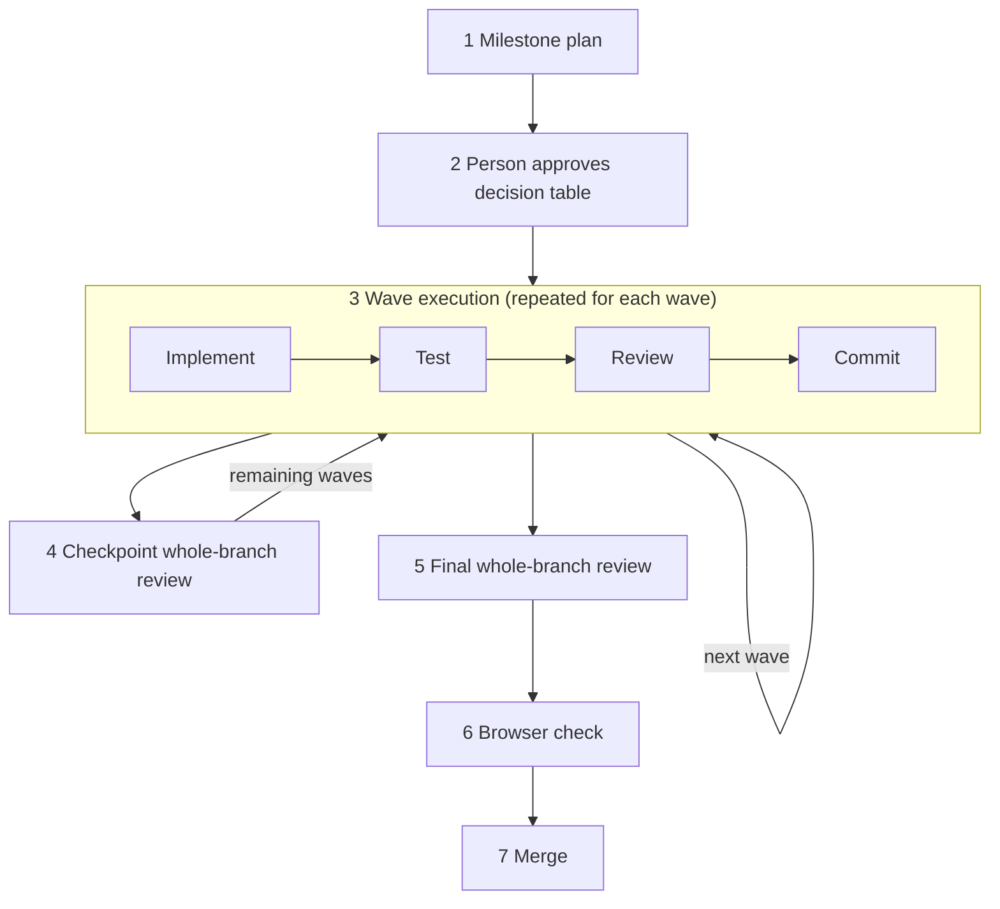

# AI-Assisted Development Method

> Version: 2026-11-18 · 繁體中文版：[ai-assisted-development.zh-TW.md](./ai-assisted-development.zh-TW.md)

## Purpose and scope

This document records the development method Durable has used from the first milestone on 2026-11-11 to now (2026-11-17, about 36,000 lines of Python, 89,000 lines of TypeScript, 102,000 lines of tests). One person owns direction and acceptance. AI agents handle plan expansion, implementation, testing and review. The aim is that this method can be copied to the next milestone, to the next project, and handed over to other people.

Scope: software projects that are organized by milestone, can be split into independent tasks, and have automated tests that decide right from wrong. Not applicable: exploratory research (the answer is not yet clear), one-off scripts, and UI fine-tuning with no tests to rely on (use the browser check for that, see Quality gates).

This document describes **what was actually done**, not an ideal process. Every section matches traces that can be verified in `docs/plans/`, `docs/reviews/`, `tests/recovery/` and the git history.

The public version does not contain `docs/plans/` and `docs/reviews/` (kept by the operator). `tests/recovery/` and the git history can be checked directly.

## Principles

1. **The plan is a contract, not a memo.** Before work starts, each task states which files change, the acceptance criteria, which tests to run, and what the reviewer should check. The agent does only what the plan says. For anything the plan does not say, it comes back and asks.
2. **Only what can be judged can be delegated.** A task handed to an agent must have a machine-checkable completion condition (tests pass, lint passes, no contract violated). For work with no way to judge it, first add a way to judge, then delegate.
3. **Reviewer agents are independent.** Implementation and review are done by different agents. The reviewer starts from a clean context and sees only the diff and the plan, not the implementer's reasoning.
4. **Boundaries rest on tools, not on reminders.** import-linter, the Alembic version check and crash-injection tests turn architecture rules into build failures. The method does not depend on an agent "remembering" a rule.
5. **Land in small steps.** One task, one commit, with the task number in the message. The milestone branch is merged into main only when complete. A failed task can be reverted alone.
6. **People guard direction and risk.** A person decides the milestone scope, approves the plan, reads the final review conclusion and decides on the merge. They do not read code line by line.
7. **Write back what was learned.** At the end of each round, the lessons are written into the plan template and into memory, so the agents of the next round know them from the start.

## Roles

There are four roles: one person and three kinds of agent. Review is done by an independent reviewer agent. It shares no context with the implementing agent and receives only the diff and the original task text.

| Role | Who | Responsible for | Not responsible for |
| --- | --- | --- | --- |
| Person | The project owner | Set the milestone scope and non-goals. Approve the decision table of the plan. Answer agents' questions. Run the browser check. Decide the merge ("a merge waits for one sentence from the user") | Reading code line by line. Writing tests. Tracking task progress |
| Orchestrator | Claude (Opus) in the main session | Research and write the milestone plan. Split tasks and arrange waves. Assign workers and reviewers. Hold the edit order of shared files and the migration lock. Collect review results and assign fixes. Make commits. Merge at the end of the milestone | Implementing tasks itself (except a one-off small fix). Reviewing code it dispatched itself |
| Worker | Claude subagents (implementation: Sonnet or Opus; testing: Sonnet). Pi is used for fast, mechanical tasks whose results can be checked | Implement strictly to the task. The tester writes the tests named in the plan and runs them to green, with no skips. Change only paths the worker Owns | Changing another task's files outside its own area. Deciding by itself a design the plan does not state (it stops and reports). Calling a real LLM (tests always use scripted `test:*` models) |
| Reviewer | A fresh Claude subagent. In the M2–M3 period the whole-branch review was done by Codex | Receives only the diff and the original task text, not the implementer's summary. Grades by Critical / Important / Minor, with a file and line, a concrete failure scenario and a suggested fix for each. Checks the brand and licensing rules | Fixing things itself. Commenting on style |

The division among the three kinds of agent was adjusted in every milestone. The combinations actually used:

| Milestone | Implementation | Testing | Review |
| --- | --- | --- | --- |
| M2 (2026-11-12) | Claude, one item by Pi | Self-tested by the implementer | Codex whole-branch review |
| M3 (2026-11-13) | Codex and Claude mixed | Self-tested by the implementer | Codex whole-branch review |
| P0 (2026-11-13) | Claude | Grok writes and runs tests | Another Grok |
| RM, SL (from 2026-11-13) | Claude subagent | Claude Sonnet subagent | Fresh Claude subagent |

The reason for converging on "all Claude": models do not share context, so the cost of a cross-model hand-off is higher than the diversity it brings. "The reviewer must be independent" rests on a clean context, not on a different model.

## Process

A milestone goes from plan to merge in seven steps. The waves in the middle repeat many times, and each wave is "implement → test → review → commit".

1. **Milestone plan**: the orchestrator researches external documents and its own code, writes the plan (format in the next section), and commits it as `docs: plan the … milestone`.
2. **Person approves the decision table**: the person reads the "Decisions" table and the "Risks and defaults" table, and takes a position only on the items they disagree with. Work starts on the rest as recommended. This is what "recommended, may start work directly" on a plan means.
3. **Wave execution**: tasks in the same wave run in parallel, each owning paths that do not overlap. Shared files follow the order the plan states, and the orchestrator waits for the previous commit to land before releasing the next. For each task: the implementer subagent implements to the specification → the tester subagent writes the tests named in the plan and runs them to green, with no skips → a fresh reviewer subagent gets only the diff and the original task text → Critical / Important findings are fixed and retested → the orchestrator commits, with the task number in the message.
4. **Checkpoint whole-branch review**: after wave 3 (P0, SL) or wave 4 (RM), one review of the whole diff. Fixes are committed as `fix(…): checkpoint review fixes after wave N`, and then the remaining waves run.
5. **Final whole-branch review**: after the last wave of the milestone, a fresh agent reviews the whole branch. Fixes are committed as `fix(…): final-review … fixes`.
6. **Browser check**: the person walks the numbered journey list in the plan against the development stack, with real data. Problems found are committed as `fix(…): browser-check … fixes`. Every milestone has this round, and not once did it produce zero fixes.
7. **Merge**: with no unresolved Critical or Important finding, the person decides in one sentence, and the milestone branch is merged into main. From 2026-11-17 this goes through a GitHub PR.

Several milestones run at the same time, each with its own branch and worktree (`milestone-p0`, `milestone-rag-memory` and `milestone-studio-layout` ran simultaneously from 2026-11-13 to 11-14). A branch in progress merges main back in regularly and records the SHA in the commit message. Early milestone branches were merged into each other (`Merge milestone-p0 into milestone-rag-memory`). From 2026-11-15 everything is merged into main.

## Plan format and task specification

There is one plan per milestone, with the date in the file name (`docs/plans/2026-11-13-milestone-rag-memory.md`), and `docs: plan the … milestone` is the first commit of the milestone. Later plans run 480–875 lines. This is the only context the agents have while working, and the more concrete it is, the less the agents guess.

The sections of a plan (shared by P0, RM and SL):

1. **Preface**: the product goal, the specifications and reference screenshots it relies on, which existing contracts remain in force, and the licensing and brand limits.
2. **Goal**: a prose description of the user journeys.
3. **Current state of the code** (with the verification date and the SHA of main) or **research summary** (external documents and its own code).
4. **Scope and non-goals**.
5. **Decision table**: Question | Recommendation | Reason. Marked "recommended, may start work directly", and the person steps in only when they disagree.
6. **Coordination rules (binding)**: layer rules, edit order of shared files, migration lock, tests do not call real models.
7. **Task table**: # | Task | Owns (the paths it owns) | Dependencies | Wave.
8. **Waves**: which tasks run at the same time, and after which wave to stop for a checkpoint review.
9. **Task details**: one subsection per task (see below).
10. **Milestone acceptance**: the browser-check list plus the full test suite.
11. **Risks and open questions**: each paired with a "default to use when work starts", so that open questions do not block progress.

**Task numbers**: the milestone prefix plus a sequence number (`P0.18`, `RM.16`, `SL.5`, `AC.13`), so references across plans are not confused. Commit messages carry the number (`feat(rm): RM.16 Knowledge pages in Studio`), so the git history and the plan can be cross-checked.

**The specification of one task** has four parts:

| Part | Content | Example |
| --- | --- | --- |
| Owns | Exact paths or modules. Paths of tasks in the same wave do not overlap | `apps/studio/src/app/knowledge/**`, `packages/run-store/src/eap_run_store/memory.py` |
| Build | The precise design: tables, columns, indexes, function names, behavior | "Migration `0012_memory`, down `0011_knowledge_bases`; table memory\_entries contains…" |
| Tester covers | The named scenarios the tester must cover: crash points, cross-tenant, limits, hash stability, migration up and down | "After a crash at `kb_batch_after_commit`, recovery gives the right chunk count and no duplicate embeddings" |
| Acceptance | One observable result | "A `test:ticket` run shows two model requests with tokens and priced cost" |

**The edit order of shared files** is the key to parallelism. The plan lists the files touched by more than one task and their order (`workflow.py: P0.1 → P0.11 → P0.17`; `lib/nav.ts: SL.4 → SL.6 → SL.7 → SL.10`), and the orchestrator waits for the previous commit to land before releasing the next. **Migration lock**: only one task at a time may add an Alembic revision, and the revision number and down-revision are fixed in the plan.

## Quality gates

There are four layers of gates, from fast to slow. Agent code must pass them in order, and the person looks only at the last layer.

| Layer | Gate | Content | Who runs it, when |
| --- | --- | --- | --- |
| 1 Structure | `uv run lint-imports` | 9 import-linter forbidden contracts in pyproject: `eap_schemas` depends on no internal package; `eap_api` never imports `eap_worker`, `eap_runtime` or `pydantic_ai`; only `eap_observability` may import OpenTelemetry; `eap_processors` and `eap_knowledge` may use only the standard library, `eap_schemas` and one external library each | Every `scripts/test.sh`; CI `python` job |
| 2 Unit and suites | `pytest`, `vitest`, `tsc --noEmit`, `next lint` | Tests do not call a real LLM. They use the scripted models `test:ticket`, `test:hash`, `test:retrieve`, `test:moderation`. The Studio test count must not fall, and the commit message states the total before and after. Test ids are a contract | The tester agent on each task; CI `python`, `studio`, `studio-test` (3 shards) |
| 3 Integration and recovery | The API suite against a real Postgres; the `tests/recovery` crash matrix | The Worker starts with `EAP_CRASH_AT=<point>` and does `os._exit(137)` (equal to kill -9) at a named crash point, and a second worker with the same executor id takes over. Each scenario asserts: the external side effect happens exactly once; `seq` is continuous with no duplicate `event_key`; the event story is as expected; the run ends in completed and the DBOS workflow has exactly one SUCCESS; SSE replay by `after_seq` / `Last-Event-ID` matches the database. There are about 20 crash points (`model_request`, `after_tool_call`, `workflow_waiting`, `kb_batch_after_commit`, `after_observation_write`…) | `scripts/test.sh`; CI Heavy (self-hosted runner; on each push to main it runs the db / run-store / API suites, and every night at 18:17 it adds the worker and recovery suites) |
| 4 Review and manual | Task review → checkpoint whole-branch review → final whole-branch review → browser check | The review conclusion is Critical / Important / Minor, and the merge standard is "no unresolved Critical or Important". The browser check is the numbered journey list in the plan, run against real data. SL adds 1440 / 1024 / 768 / 400 px, light and dark themes, keyboard only, Lighthouse a11y ≥ 95, no horizontal scroll at 400 px, and a brand-word grep | The checkpoint comes after wave 3 (P0, SL) or wave 4 (RM). The final review and browser check come before the merge |

The form of a review report (`docs/reviews/2026-11-13-milestone-2-final-review.md`): `## Verdict`, then each `### Critical|Important|Minor — one-sentence conclusion`, with a **File:** path and line, an explanation, a **concrete failure scenario** (inference is marked as such) and a **suggested fix** (usually naming the missing test); then `## Checked and fine` and `## Commands run`. From P0 on, reviews are no longer saved to files and turn directly into commits such as `fix(rm): final-review backend fixes`. The conclusion of the first two reviews was "not ready", and not one merge passed on the first version.

**Deployment gate**: `deploy.yml` can only be triggered manually, with the input "deploy", limited to the repository owner and to main. Secrets are obtained from a password-manager service at deploy time and are not stored in GitHub. After deployment, a loopback smoke test runs against the API and Studio. The `deploy-checks` job runs kubeconform, shellcheck and actionlint on the k8s manifests in every CI run.

## Toolchain and environment

| Layer | Tool | Use |
| --- | --- | --- |
| Harness | Claude Code (orchestrator and subagents); Orca (multiple workers, each in its own worktree, ask/reply, worker\_done); Pi (mechanical tasks) | One orchestrator session assigns workers, and each worker works in its own worktree and is released when done |
| Version control | git worktree, one branch per milestone (`milestone-p0`, `milestone-rag-memory`, `milestone-studio-layout`); from 2026-11-17, GitHub PRs | Several milestones run at the same time. A branch in progress merges main back in regularly and records the SHA |
| Local development stack | `scripts/dev-up.sh` / `dev-down.sh` / `dev-status.sh` / `dev-worker.sh` | Start postgres, otel-lgtm, worker, api and studio in order and wait for health checks. The worker is restarted by a supervisor loop, with a fixed executor id for recovery |
| Model access | Self-hosted LiteLLM gateway (on a self-hosted host). Long responses go through an SSH tunnel to avoid the Cloudflare 300-second limit | The platform and the agents use the same gateway. Streaming usage for qwen3 needs a container patch, which must be re-applied after a redeploy |
| Embedding | Qwen3-VL-Embedding-8B, 1024 dimensions, through the same gateway | Knowledge bases and semantic recall. Images are embedded through the gateway as data URLs |
| CI | GitHub Actions `ci.yml` (path filters, python, studio, studio-test × 3, deploy-checks); `ci-heavy.yml` (self-hosted runner, Postgres in a colima container on port 54359) | Hosted takes about 18 minutes. Heavy has no Loki, so Loki tests are skipped by default unless `EAP_REQUIRE_LOKI=1` |
| Plans and memory | `docs/plans/`, `docs/reviews/`; the orchestrator's file memory (one file per fact, with the reason and how to apply it) | Keep decisions and lessons across sessions. The plan is the agents' context, and memory is the orchestrator's |

**Environment rules**: each worker acts only in its own worktree or under the paths it Owns. In a shared checkout it stages only its own paths and retries on `index.lock`. Messages to agents are read from a file (`--body-file`), so that embedded backticks are not run by the shell. A subagent does not dispatch subagents and wait for results (it hangs).

## Harness

A harness is the execution framework wrapped around a model that lets it actually do things. It connects tools (read files, run commands, call APIs) to the model, manages permissions and sandboxes, maintains context and memory, intercepts and records every tool call, and schedules subagents. The model only produces text. The harness turns the text into actions and feeds the results back. Claude Code, Codex CLI and Orca are harnesses. The Worker of Durable is also a kind of harness for the agents it runs (tool registry, durable steps, model allow list).

One of the harness's jobs is to state the boundaries clearly, so the agent does not have to guess. The split criteria are written into the plan's Owns column and the layer rules, the anti-patterns are written into the reviewer agent's prompt, and the agent implements within the boundaries. The next two sections give the concrete content of these boundaries.

### When to split a boundary

The reason for a split must be one of the following five. "It looks cleaner" does not count.

| Reason to split | Question to ask | Example in Durable |
| --- | --- | --- |
| Different trust | Is it acceptable for different people to change these two pieces of code? | A tenant's flow is data and the platform's flow is code. A tenant can never send code into the Worker |
| Different lifetime | Does an object on one side live longer than the process on the other? | A run (minutes to days) versus a process (restarts at any time). So run state is in Postgres, not in Worker memory |
| Different failure domain | If one side goes down, should the other keep serving? | The API and Worker do not talk directly and share only the database. When the Worker is fully down, Studio can still read history and enqueue new runs |
| Different dependency weight | Must this code run without a large dependency installed? | `eap_api` never imports `pydantic_ai` or DBOS. `eap_processors` and `eap_knowledge` are pure functions with only the standard library and one external library |
| A resource can have only one owner | If both places could do it, would they conflict? | Only Alembic (`eap_db`) can change the schema. Event `seq` is assigned under a single row lock |

When not to split: code of the same deployment unit, the same lifetime and the same trust level, split into two services, only adds a network hop and a kind of inconsistency. The answer of Durable is one Postgres that holds the queue, events, vectors and memory, instead of Redis + Kafka + a vector store. Splits also come in levels: try a package boundary first (an import-linter contract), then a process boundary (API / Worker), and a service boundary last. Durable did not reach the third level.

**Boundaries are set by a person and adjusted by a person.** At the start of a milestone, the person sets the boundaries in the briefing and the decision table, and the orchestrator writes them into the plan (the Owns column, the layer rules, the import-linter contract for a new package). Workers do not decide them. But boundaries change during iteration: halfway through, it turns out something must cross a layer, a package should be split, or a contract blocks a reasonable need. The rules then are:

1. The worker **stops and reports**, saying which boundary blocks it and why, and does not work around it (the original wording of the SL plan: "do not change the API, Worker or migrations; a task that needs them stops and reports").
2. The orchestrator turns the options into one decision (question / recommendation / reason), with the affected tasks and contracts attached.
3. **The person decides.** If they agree, the orchestrator first changes the contracts (import-linter, Owns) and the plan, and then lets the worker continue. If they disagree, the task changes its approach within the original boundary.
4. The change is recorded in the plan's decision table and in the commit message, and at the end of the milestone it is written back into the package layering section of the Architecture Design.

Why a person must step in: the boundaries are written in the plan and the contracts, but an agent's context is lost. Late in a long task, across a session resume, or when working across branches, the reason the boundary was set is no longer in the agent's window, and it will push the boundary open without noticing. The person is the only one who spans all sessions and remembers why it was drawn this way, so a person decides on changing a boundary. The tool (import-linter) makes an un-approved crossing fail the build, so stopping to report is the only path open.

### Backend architecture anti-patterns

Code produced by agents falls especially easily into the following anti-patterns. The reviewer checks them one by one, and the first eight are Critical in Durable.

| Anti-pattern | Why agents often commit it | Rule in Durable |
| --- | --- | --- |
| Waiting in process memory (sleep, polling, waiting for approval inside a handler) | It is the most direct way to write it | A wait is state in the database (DBOS `recv`), and it reconnects automatically after a process restart |
| A non-idempotent side effect | "Call an external API" is written as one line | Reserve → call → complete, key = `run_id:tool_call_id`. An interruption after the call goes to `needs_attention` and is never retried automatically |
| Hidden non-determinism in replayed steps | `datetime.now()`, a "latest version" query or a random number written outside a step | The clock, version resolution, environment limits and deadlines are each read once inside a recorded step |
| Automatic retry masking errors | "Add a retry decorator" is taken as robustness | A model request may be retried and a side effect may not. A retry must sit on a step boundary |
| The API calls the Worker directly (distributed monolith) | For two processes, the shortest path is HTTP | Zero direct communication. The API writes rows and enqueues, and the Worker dequeues. `eap_api` not importing `eap_worker` is enforced by lint |
| Changing the schema in application code (`create_all`, adding a column on a model with no migration) | It is the fastest way to get tests green | Alembic is the only schema owner. The API and Worker refuse to start when not at head. A migration needs a downgrade and a test |
| A cross-tenant query missing `tenant_id` | A row can be fetched by primary key | Every query carries the tenant. Child rows are bound to the tenant by composite foreign keys. An id from another tenant returns 404, not 403. The reserved names `tenant_id`, `user_id` and `run_id` are not accepted from the client |
| Using the model to decide flow branches | "Let the LLM decide the next step" is tempting | A branch condition is a data comparison. If the model must judge, have the agent output a field and let the flow compare it |
| Logs, errors and spans leaking secrets and input | Printing everything while debugging | The request guard does not echo input. MCP header values are encrypted and not returned. Tool results, errors and spans all go through masking |
| A huge `utils.py` / `helpers.ts` | The agent cannot find where to put it and puts it here | The plan's Owns names the file. The reviewer raises Important on a new general-purpose module |
| Re-implementing a function that already exists | The agent writes without searching first | The "Current state of the code" section of the plan lists reusable modules. The tester checks for parallel implementations |
| One big PR, generated code with no tests | The agent writes the whole feature in one go | One task, one commit. The tester is an independent role, and the test count must not fall |
| Doing I/O in `__init__` or at module load | "Connect once at startup is enough" | Connections and settings go in an explicit startup function. Pure packages (schemas, processors, knowledge) have no I/O, which lint guarantees |

How to use this table: when writing a plan, the Tester covers column of each task points to at least one of these (cross-tenant, crash point, idempotency). The reviewer's prompt lists this table directly. A new anti-pattern the table does not cover is added at the end of the milestone.

## Lessons learned and anti-patterns

Every item comes from something that actually happened, written as "symptom → rule".

| Symptom | Rule |
| --- | --- |
| The conclusion of both final reviews was "not ready", and the browser check of every milestone produced fix commits | Reserve one round of fixes in the plan. Do not take "passes on the first version" as the goal. Review and the browser check find what tests cannot (cross-page flows, empty states, permission boundaries) |
| Cross-model hand-offs (Codex reviews, Grok tests, Claude writes) do not share context, and the hand-off notes still miss things however long they are | Use only Claude. The reviewer's independence rests on a clean context, not on a different model. Pi is used only for fast, mechanical tasks whose results can be checked |
| A subagent dispatches a subagent and waits for results, the whole chain hangs, and the result goes back to the orchestrator and not to the agent that dispatched it | A subagent does not dispatch subagents. If parallelism is needed, the orchestrator dispatches directly. State this in the briefing |
| Several workers in one checkout overwrite each other's staging and hit `index.lock` | One worker per worktree. When shared, stage only your own paths and retry on a lock. Dispatch every follow-up verification explicitly and do not assume it will run by itself |
| A message to an agent embeds backticks and the shell runs them as a command | Always read messages from a file (`--body-file`, a quoted heredoc) |
| A finished worker is not released and the queue stays occupied | Release on done / stop. Periodically sweep for dispatches that are not ready or not released |
| A long model response is cut by Cloudflare at 300 seconds | The self-hosted gateway goes through an SSH tunnel (`studio-tunnel`), not through Cloudflare |
| The patch on the gateway container (streaming usage) disappears after a redeploy | Keep the patch file in the operator's patch store, add "re-apply the patch" to the redeploy checklist, and in the long term move it into the container build |
| The Heavy runner has no Loki and the related tests skip silently | Tests skip by default and print the reason. Force them with `EAP_REQUIRE_LOKI=1` when needed. Write the CI configuration into memory |
| Early plans of 58–133 lines made agents guess the design. Later plans of 480–875 lines caused little rework | Plan length is not the problem. Be concrete down to tables, columns, function names, crash points and acceptance results |
| A shared file edited by two tasks at the same time | The plan lists shared files and their order. The migration lock allows one at a time |
| An architecture rule the agent "remembers" loosens late in a long task | Put rules into tools: import-linter, the Alembic head check, the rule that the test count must not fall |

**Anti-patterns** (replaced by the rules in the table above, listed so they can be recognized): letting the implementer review their own work; one big task with one big commit; using a prompt to remind agents to respect layering; cross-model hand-offs for the sake of "diversity"; a person reading agent code line by line instead of the review conclusion; a plan that says "build a knowledge base feature" without tables and columns.

## Metrics and continuous improvement

**Output** (2026-11-11 to 11-17, one human author, commits attributed to Claude Opus 5.5 / Fable 5.1 / Sonnet 5.5): commits per day 23, 13, 38, 34, 98, 32, 133; about 36,000 lines of Python, 89,000 lines of TypeScript, 102,000 lines of tests (test-to-code ratio about 0.8); 13 migrations; 5 milestones merged into main (M1, M2, M3, P0, RAG/memory + Studio layout).

**Quality signals**: the final review and the browser check of each milestone each produced 1–2 fix commits; the crash matrix has 19 crash points and 6 test files; Studio has about 179 test files, and the test count only grows.

**Metrics to keep tracking**:

| Metric | Why | How to measure |
| --- | --- | --- |
| Review round trips per task | Whether the plan is concrete enough | Review fix commits ÷ tasks; target < 0.5 |
| Findings of the browser check | The blind spots of automated tests | Number of fix items in `browser-check` commits per milestone; the trend should fall |
| Time from task spec to commit | Agent throughput and stalls | Time from task start to commit; look at outliers |
| Test count and test-to-code ratio | Whether tests keep up | CI prints the total; commit messages state the before and after |
| Crash-point coverage | Whether every new durable step has a crash test | New `eap.*` steps vs new `crash_point`s |
| Cross-tenant test coverage | Whether isolation is tested on every new endpoint | New endpoints vs new cross-tenant tests |

**Improvement loop**: at the end of each milestone, the orchestrator writes the lessons of the round back to two places: the plan template (the "Coordination rules" section of the next plan) and the orchestrator's memory (one file per fact, with the reason and how to apply it). The "Lessons learned" table above is the output of this loop. The next things to add: write the deployment version strategy (DBOS app version) as a rule; add the anti-pattern table to the reviewer's prompt.
