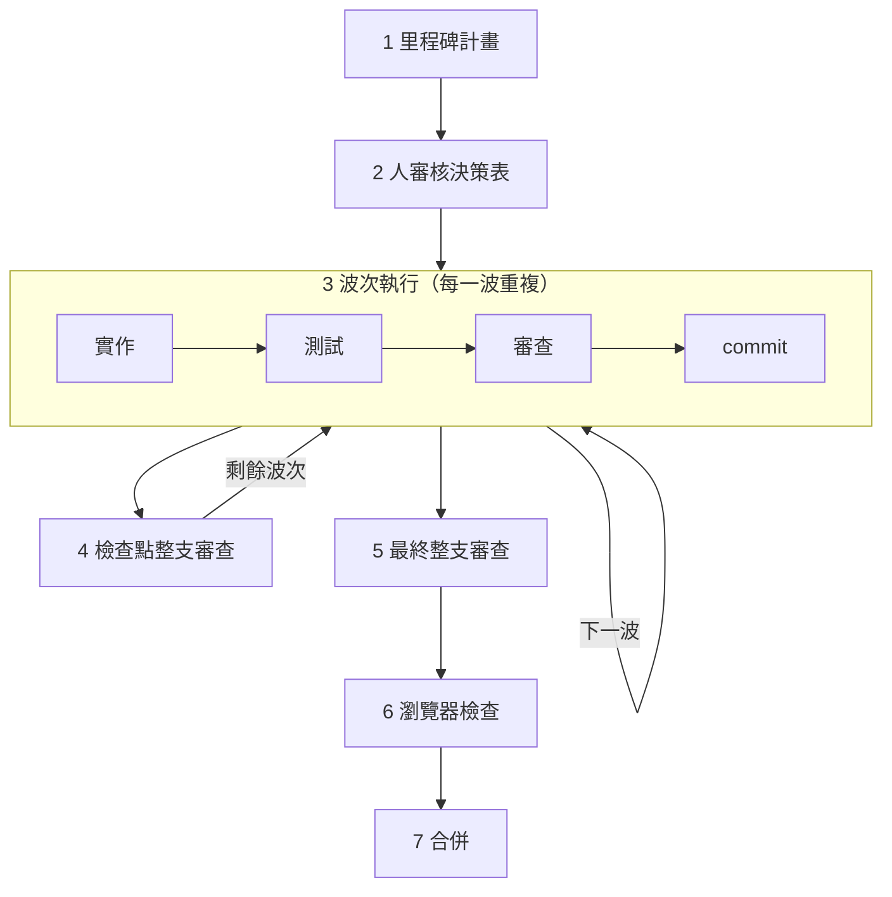

# AI 輔助開發流程方法

> 版本：2026-11-18

## 目的與適用範圍

本文件記錄本方案從 2026-11-11 第一個里程碑到目前（2026-11-17，約 36,000 行 Python、89,000 行 TypeScript、102,000 行測試）所採用的開發方法：一個人負責方向與驗收，AI 代理負責計畫展開、實作、測試與審查。目的是讓這套方法可以被複製到下一個里程碑、下一個專案，以及交接給其他人。

適用範圍：以里程碑為單位、可拆成多個獨立任務、有自動化測試可判定對錯的軟體專案。不適用：探索性研究（答案尚不明確）、一次性腳本、以及沒有測試可依的 UI 微調（這類工作改用瀏覽器檢查，見品質關卡）。

本文件描述的是**實際使用過的做法**，不是理想流程；每一節都對應到 `docs/plans/`、`docs/reviews/`、`tests/recovery/` 與 git 歷史裡可查證的痕跡。

公開版本不含 `docs/plans/` 與 `docs/reviews/`（營運端保存）；`tests/recovery/` 與 git 歷史可直接查證。

## 原則

1. **計畫是契約，不是備忘。** 每個任務在動工前寫清楚：改哪些檔案、驗收條件、要跑哪些測試、審查者該檢查什麼。代理只做計畫上寫的事；計畫沒寫的，回來問。
2. **可判定才可委派。** 交給代理的任務必須有機器可判定的完成條件（測試通過、lint 通過、契約不違反）。沒有判定方式的工作，先補判定方式，再委派。
3. **審查代理獨立。** 實作與審查由不同的代理執行，審查者從乾淨上下文出發，只看 diff 與計畫，不看實作者的思路。
4. **邊界靠工具，不靠提醒。** import-linter、Alembic 版本檢查、崩潰注入測試把架構規則變成建置失敗；不依賴代理「記得」規則。
5. **小步落地。** 一個任務一個 commit，訊息帶任務編號；里程碑分支完成後才合併 main。失敗的任務可以單獨回退。
6. **人守方向與風險。** 人決定里程碑範圍、審核計畫、看最終審查結論、拍板合併；不逐行讀程式碼。
7. **把學到的寫回去。** 每輪結束把教訓寫進計畫範本與記憶，下一輪的代理從一開始就知道。

## 角色分工

四種角色，一人與三類代理。審查由獨立的審查代理執行：它與實作代理不共用上下文，只拿到 diff 與任務原文。

| 角色 | 誰 | 負責 | 不負責 |
| --- | --- | --- | --- |
| 人 | 專案負責人 | 定里程碑範圍與非目標；審核計畫的決策表；回答代理的問題；跑瀏覽器檢查；拍板合併（「合併要等使用者一句話」） | 逐行讀程式碼；寫測試；追蹤任務進度 |
| 編排者 | 主會話的 Claude（Opus） | 研究與撰寫里程碑計畫；拆任務、排波次；指派工作者與審查者；持有共用檔案的編輯順序與遷移鎖；收審查結果、指派修正；提交 commit；在里程碑結束時合併 | 自己實作任務（除非一次性小修）；審查自己分派出去的程式碼 |
| 工作者 | Claude 子代理（實作：Sonnet 或 Opus；測試：Sonnet）；Pi 用於快速、機械性、結果可檢查的任務 | 依任務訪格實作；測試者寫計畫列名的測試並跑到綠、不允許 skip；只改自己 Owns 的路徑 | 越欄改別的任務的檔案；自行决定計畫未寫的設計（停下來回報）；呼叫真実 LLM（測試一律用腳本模型 `test:*`） |
| 審查者 | 全新的 Claude 子代理；M2–M3 時期的整支審查由 Codex 執行 | 只拿到 diff 與任務原文，不拿實作者的摘要；依 Critical / Important / Minor 分級，每條帶檔案行號、具體失敗情境、建議修正；檢查品牌與授權規則 | 自己動手修；評論風格 |

三類代理的分工在每個里程碑都有調整，實際走過的組合：

| 里程碑 | 實作 | 測試 | 審查 |
| --- | --- | --- | --- |
| M2（2026-11-12） | Claude，一項 Pi | 實作者自測 | Codex 整支審查 |
| M3（2026-11-13） | Codex 與 Claude 混用 | 實作者自測 | Codex 整支審查 |
| P0（2026-11-13） | Claude | Grok 寫測試並執行 | 另一個 Grok |
| RM、SL（2026-11-13 起） | Claude 子代理 | Claude Sonnet 子代理 | 全新 Claude 子代理 |

最後收斂到「全部用 Claude」的原因：模型間上下文不共用，跨模型交接的成本高於其帶来的多樣性；「審查者要獨立」靠的是乾淨的上下文，不是不同的模型。

## 流程

一個里程碑從計畫到合併走七步；中間的波次重複多次，每一波都是「實作 → 測試 → 審查 → commit」。

1. **里程碑計畫**：編排者研究外部文件與自己的程式碼，寫出計畫（格式見下節），以 `docs: plan the … milestone` 提交。
2. **人審核決策表**：人看「決策」表與「風險與預設」表，只對不同意的項目表態；其餘照建議動工。計畫上標「建議，可直接動工」就是這個意思。
3. **波次執行**：同一波的任務並行，各自擁有不相重疊的路徑；共用檔案依計畫寫明的順序，編排者等前一個 commit 落地再放行下一個。每個任務：實作者子代理依規格實作 → 測試者子代理寫計畫列名的測試並跑到綠、不允許 skip → 全新審查者子代理只拿 diff 與任務原文 → Critical / Important 修正並重測 → 編排者提交，訊息帶任務編號。
4. **檢查點整支審查**：wave 3（P0、SL）或 wave 4（RM）之後，一次整支 diff 的審查；修正以 `fix(…): checkpoint review fixes after wave N` 提交，再跑剩餘波次。
5. **最終整支審查**：里程碑最後一波之後，全新代理審整支；修正以 `fix(…): final-review … fixes` 提交。
6. **瀏覽器檢查**：人對開發棧走計畫裡的編號旅程清單，真數據；發現的問題以 `fix(…): browser-check … fixes` 提交。每個里程碑都有這一輪，沒有一次是零修正。
7. **合併**：沒有未解的 Critical 或 Important，人一句話拍板，里程碑分支合併 main；2026-11-17 起改走 GitHub PR。

多個里程碑同時進行，各自一個分支與 worktree（`milestone-p0`、`milestone-rag-memory`、`milestone-studio-layout` 在 2026-11-13 至 11-14 同時進行）；進行中的分支定期把 main 合回來並在 commit 訊息記 SHA。早期里程碑分支互相合併（`Merge milestone-p0 into milestone-rag-memory`），2026-11-15 起統一合進 main。

## 計畫文件格式與任務規格

一個里程碑一份計畫，檔名帶日期（`docs/plans/2026-11-13-milestone-rag-memory.md`），以 `docs: plan the … milestone` 為里程碑的第一個 commit。後期的計畫長 480–875 行；這是代理工作時唯一的上下文，寫得越具體，代理越少猜。

計畫的章節（P0、RM、SL 共用）：

1. **前言**：產品目標、依據的規格與參考截圖、哪些既有契約繼續有效、授權與品牌限制。
2. **目標**：使用者旅程的散文描述。
3. **程式碼現狀**（標注驗證日期與 main 的 SHA）或**研究摘要**（外部文件與自己的程式碼）。
4. **範圍與非目標**。
5. **決策表**：問題 | 建議 | 理由。標註「建議，可直接動工」，人只在不同意時介入。
6. **協調規則（具約束力）**：層級規則、共用檔案的編輯順序、遷移鎖、測試不呼叫真実模型。
7. **任務表**：# | 任務 | Owns（擁有的路徑）| 依賴 | 波次。
8. **波次**：哪些任務同時跑，哪一波後停下來做檢查點審查。
9. **任務細節**：每任務一小節（見下）。
10. **里程碑驗收**：瀏覽器檢查清單加完整測試套件。
11. **風險與未決問題**：每條配一個「動工時先用的預設」，不讓未決問題卡住進度。

**任務編號**：里程碑前置加序號（`P0.18`、`RM.16`、`SL.5`、`AC.13`），跨計畫引用時不會混淆；commit 訊息帶編號（`feat(rm): RM.16 Knowledge pages in Studio`），git 歷史跟計畫可互查。

**一個任務的規格**四段：

| 段 | 內容 | 例 |
| --- | --- | --- |
| Owns | 確切路徑或模組；同一波的任務路徑不重畳 | `apps/studio/src/app/knowledge/**`、`packages/run-store/src/eap_run_store/memory.py` |
| Build | 精確設計：表、欄位、索引、函式名、行為 | 「遷移 `0012_memory`，down `0011_knowledge_bases`；表 memory\_entries 含…」 |
| Tester covers | 測試者必須覆蓋的具名情境：崩潰點、跨租戶、上限、雜湊穩定、遷移上下 | 「在 `kb_batch_after_commit` 崩潰後恢復，切塊數正確、無重複嵌入」 |
| Acceptance | 一個可觀察的結果 | 「`test:ticket` 執行顯示兩次模型請求、帶 token 與計價成本」 |

**共用檔案的編輯順序**是並行的關鍵：計畫列出會被多個任務碰到的檔案與順序（`workflow.py: P0.1 → P0.11 → P0.17`；`lib/nav.ts: SL.4 → SL.6 → SL.7 → SL.10`），編排者等前一個 commit 落地才放行下一個。**遷移鎖**：同時只有一個任務可新增 Alembic 版本，版本號與 down-revision 在計畫裡就定好。

## 品質關卡

關卡分四層，由快到慢；代理的程式碼必須依序通過，人只看最後一層。

| 層 | 關卡 | 內容 | 誰跑、何時 |
| --- | --- | --- | --- |
| 1 結構 | `uv run lint-imports` | pyproject 裡 9 条 import-linter 禁止契約：`eap_schemas` 不依賴任何內部套件；`eap_api` 永不 import `eap_worker`、`eap_runtime`、`pydantic_ai`；只有 `eap_observability` 可 import OpenTelemetry；`eap_processors`、`eap_knowledge` 只能用標準庫、`eap_schemas` 與各自的一個外部庫 | 每次 `scripts/test.sh`；CI `python` job |
| 2 單元與套件 | `pytest`、`vitest`、`tsc --noEmit`、`next lint` | 測試不呼叫真実 LLM，用腳本模型 `test:ticket`、`test:hash`、`test:retrieve`、`test:moderation`；Studio 測試數不得下降，commit 訊息寫前後測試總數；測試 id 是契約 | 測試者代理每任務；CI `python`、`studio`、`studio-test`（3 片） |
| 3 整合與恢復 | API 套件對真 Postgres；`tests/recovery` 崩潰矩陣 | Worker 以 `EAP_CRASH_AT=<point>` 啟動，在具名崩潰點 `os._exit(137)`（等同 kill -9），第二個同 executor id 的 worker 接手。每個情境斷言：外部副作用恰好一次；`seq` 連續無重複 `event_key`；事件故事符合預期；執行結束在 completed，DBOS workflow 恰一個 SUCCESS；SSE 以 `after_seq` / `Last-Event-ID` 重放與資料庫一致。崩潰點約 20 個（`model_request`、`after_tool_call`、`workflow_waiting`、`kb_batch_after_commit`、`after_observation_write`…） | `scripts/test.sh`；CI Heavy（自架主機 runner，每次 push main 跑 db / run-store / API 套件，每夜 18:17 加跑 worker 與 recovery） |
| 4 審查與人工 | 任務審查 → 檢查點整支審查 → 最終整支審查 → 瀏覽器檢查 | 審查結論為 Critical / Important / Minor，合併標準是「沒有未解的 Critical 或 Important」。瀏覽器檢查是計畫裡的編號旅程清單，對真數據跑；SL 增加 1440 / 1024 / 768 / 400 px、深淺色、純鍵盤、Lighthouse a11y ≥ 95、400 px 無水平捲動、品牌字 grep | 檢查點在 wave 3（P0、SL）或 wave 4（RM）後；最終審查與瀏覽器檢查在合併前 |

審查報告的形式（`docs/reviews/2026-11-13-milestone-2-final-review.md`）：`## Verdict`，然後每條 `### Critical|Important|Minor — 一句話結論`，帶 **File:** 路徑與行號、說明、**具體失敗情境**（推論要標明）、**建議修正**（通常是指名缺的測試）；再來 `## Checked and fine` 與 `## Commands run`。從 P0 起審查不再落檔，直接變成 `fix(rm): final-review backend fixes` 這類 commit；前兩次審查的結論都是「not ready」，没有一次合併是第一版就過。

**部署關卡**：`deploy.yml` 只能手動觸發，輸入 「deploy」、限 repository owner、限 main；秘密從 密碼管理服務 在部署時取得，GitHub 不存。部署後對 API 與 Studio 跑回路 smoke test。`deploy-checks` job 在每次 CI 對 k8s manifest 跑 kubeconform、shellcheck、actionlint。

## 工具鏈與環境

| 層 | 工具 | 用途 |
| --- | --- | --- |
| 代理執行框架 | Claude Code（編排者與子代理）；Orca（多工作者、各自的 worktree、ask/reply、worker\_done）；Pi（機械性任務） | 一個編排者會話指派工作者，每個工作者在自己的 worktree 工作，完成後釋放 |
| 版本控制 | git worktree，一個里程碑一個分支（`milestone-p0`、`milestone-rag-memory`、`milestone-studio-layout`）；2026-11-17 起改走 GitHub PR | 多個里程碑同時進行；進行中的分支定期把 main 合回来並記錄 SHA |
| 本地開發棧 | `scripts/dev-up.sh` / `dev-down.sh` / `dev-status.sh` / `dev-worker.sh` | 依序啟動 postgres、otel-lgtm、worker、api、studio 並等健康檢查；worker 由監督迴圈重啟，executor id 固定以便恢復 |
| 模型存取 | 自架 LiteLLM 閘道（自架主機）；長回應走 SSH 隧道避開 Cloudflare 300 秒上限 | 平台本身和代理都經同一個閘道；qwen3 的串流用量需要容器補丁，重部署後要重上 |
| 嵌入 | Qwen3-VL-Embedding-8B，1024 維，經同一閘道 | 知識庫與語意回想；圖片以 data URL 經閘道嵌入 |
| CI | GitHub Actions `ci.yml`（路徑過濾、python、studio、studio-test × 3、deploy-checks）；`ci-heavy.yml`（自架 runner，Postgres 在 colima 容器 54359 端口） | hosted 約 18 分；heavy 沒有 Loki，Loki 測試預設 skip，除非 `EAP_REQUIRE_LOKI=1` |
| 計畫與記憶 | `docs/plans/`、`docs/reviews/`；編排者的檔案記憶（一個檔一件事，含原因與怎麼用） | 跨會話保留決策與教訓；計畫是代理的上下文，記憶是編排者的 |

**環境規則**：每個工作者只在自己的 worktree 或自己 Owns 的路徑下動作，共用 checkout 時只 stage 自己的路徑、遇 `index.lock` 重試；給代理的訊息從檔案讀（`--body-file`），避免內嵌反引號被 shell 執行；子代理不再派子代理等結果（會卡住）。

## 代理執行框架（Harness）

Harness 是包在模型外面、讓它能實際做事的執行框架：把工具（讀檔、跑指令、呼叫 API）接給模型，管理權限與沙箱，維持上下文與記憶，攔截與記錄每次工具呼叫，排程子代理。模型只產生文字；harness 把文字變成動作、把結果餵回去。Claude Code、Codex CLI、Orca 都是 harness；本方案的 Worker 對它執行的 Agent 也是一種 harness（工具註冊、持久步驟、模型允許清單）。

Harness 的工作之一是把邊界說清楚，讓代理不必猜：拆分準則寫進計畫的 Owns 欄與層級規則，反模式寫進審查代理的提示，代理在邊界內實作。下面兩節是這套邊界的具體內容。

### 什麼時候拆分邊界

拆分的理由必須是下列五種之一；「看起來比較乾淨」不算。

| 拆分的理由 | 判斷問句 | 本方案的例子 |
| --- | --- | --- |
| 信任不同 | 這兩塊程式碼是否允許被不同的人改？ | 租戶的流程是資料，平台的流程是程式碼；租戶永遠不能把程式碼送進 Worker |
| 壽命不同 | 一边的物件是否活得比另一边的行程還久？ | 執行（分鐘到天）对行程（隨時重啟）：所以執行狀態在 Postgres，不在 Worker 記憶體 |
| 故障域不同 | 一边挂了，另一边該不該繼續服務？ | API 與 Worker 不直接通訊，只共用資料庫；Worker 全掃時 Studio 仍能讀歷史、排新執行 |
| 依賴重量不同 | 這塊程式碼是否必須在不裝某個大依賴的情況下跑？ | `eap_api` 永不 import `pydantic_ai`、DBOS；`eap_processors` 與 `eap_knowledge` 是純函式，只有標準庫與一個外部庫 |
| 資源只能有一個主人 | 這件事若兩處都能做，會不會打架？ | Schema 只有 Alembic（`eap_db`）能改；事件 `seq` 只在一個列鎖下配號 |

不該拆的情況：同一部署單位、同一壽命、同一信任等級的程式碼拆成兩個服務，只會多一次網路、多一種不一致。本方案的答案是一個 Postgres 承載佇列、事件、向量、記憶，而不是 Redis + Kafka + 向量庫。拆分的形式也分層級：先試套件邊界（import-linter 契約），再試行程邊界（API / Worker），最後才是服務邊界；本方案沒有走到第三層。

**邊界由人界定，也由人調整。** 里程碑開始時，人在簡報與決策表裡定邊界，編排者寫進計畫（Owns 欄、層級規則、新套件的 import-linter 契約），工作者不自己決定。但邊界在迭代中會變：做到一半發現某件事必須跨層、某個套件該拆、某條契約擋到合理的需求。這時的規則是：

1. 工作者**停下來回報**，說明哪條邊界擋住、為什麼，不自行繞過（SL 計畫的原文：「不改 API、Worker、遷移；需要的任務停下來回報」）。
2. 編排者把選項整理成一條決策（問題 / 建議 / 理由），附上影響的任務與契約。
3. **人拍板**。同意後，編排者先改契約（import-linter、Owns）與計畫，再讓工作者繼續；不同意，任務在原邊界內改做法。
4. 變動記進計畫的決策表與 commit 訊息，里程碑結束時回寫架構文件的套件分層節。

為什麼要人介入：邊界是寫在計畫與契約裡的，但代理的上下文會流失。長任務後段、會話接續、跨分支工作時，當初定邊界的理由已經不在代理的視窗裡，它會在不自覺的情況下把邊界推開。人是唯一跨越所有會話、記得為什麼這样劃的人，所以調整邊界由人拍板。工具（import-linter）讓沒經拍板的越界建置失敗，所以停下來回報是唯一能走的路。

### 後端架構反模式

代理產出的程式碼特別容易落入下列反模式；審查者逐條檢查，其中前八條在本方案是 Critical。

| 反模式 | 為什麼代理常犯 | 本方案的規則 |
| --- | --- | --- |
| 在行程記憶體裡等待（sleep、輪詢、在 handler 裡等審批） | 最直接的寫法 | 等待是資料庫裡的狀態（DBOS `recv`），行程重啟後自動接回 |
| 非冪等的副作用 | 「呼叫外部 API」被寫成一行 | 預留 → 呼叫 → 完成，key = `run_id:tool_call_id`；中斷在呼叫後進 `needs_attention`，永不自動重試 |
| 重放步驟裡的隱藏非決定性 | `datetime.now()`、「最新版本」查詢、隨機數寫在步驟外 | 時鐘、版本解析、環境上限、期限都在一個被記錄的步驟裡讀一次 |
| 自動重試掩蓋錯誤 | 「加個 retry 裝飾器」當作強健 | 模型請求可重試，副作用不可；重試要寫在步驟邊界上 |
| API 直接呼叫 Worker（分散式單體） | 兩個行程最短路徑是 HTTP | 零直接通訊；API 寫列、排佇列，Worker 取出；`eap_api` 不 import `eap_worker` 由 lint 強制 |
| 在應用程式碼裡改 schema（`create_all`、在 model 上加欄不寫遷移） | 最快讓測試綠 | Alembic 是唯一 schema 所有者；API 與 Worker 在非 head 時拒絕啟動；遷移要有 downgrade 與測試 |
| 跨租戶查詢少了 `tenant_id` | 從主鍵查就能拿到列 | 每個查詢都帶租戶；子列用複合外鍵綁租戶；他租戶 id 回 404 不是 403；保留字 `tenant_id`、`user_id`、`run_id` 不接受客戶端輸入 |
| 用模型判斷流程分支 | 「讓 LLM 決定下一步」很誘人 | 分支條件是資料比對；要模型判斷，就讓 Agent 輸出一個欄位，再由流程比對它 |
| 日誌、錯誤、span 洩漏秘密與輸入 | 除錯時满突印 | 請求守衛不回顯輸入；MCP 標頭值加密且不回傳；工具結果、錯誤、span 都經過遮罩 |
| 巨大的 `utils.py` / `helpers.ts` | 代理找不到該放哪就放這裡 | 計畫的 Owns 指定檔案；審查者對新增的通用模組提 Important |
| 重複實作已存在的函式 | 代理不先搜尋就寫 | 計畫的「程式碼現狀」節列出可重用的模組；測試者檢查有無平行實作 |
| 一次大 PR、沒有測試的生成碼 | 代理一口氣寫完整個功能 | 一任務一 commit；測試者是獨立角色，測試數不得下降 |
| 在 `__init__` 或模組載入時做 I/O | 「啟動時連一次就好」 | 連線、設定在顯式的啟動函式；純套件（schemas、processors、knowledge）無 I/O，由 lint 保證 |

這張表的用法：寫計畫時，每個任務的 Tester covers 欄至少指到其中一條（跨租戶、崩潰點、冪等）；審查者的提示直接列入這張表。表沒有涵蓋的新反模式，在里程碑結束時補進來。

## 經驗教訓與反模式

每一條都來自實際發生過的事，寫成「現象 → 規則」。

| 現象 | 規則 |
| --- | --- |
| 兩次最終審查的結論都是「not ready」，每個里程碑的瀏覽器檢查都產生修正 commit | 計畫裡預留一輪修正；不把「第一版就過」當作目標。審查與瀏覽器檢查找到的是測試找不到的東西（跨頁流程、空狀態、權限邊界） |
| 跨模型交接（Codex 審、Grok 測、Claude 寫）上下文不共用，交接說明寫得再多仍漏 | 全部用 Claude；審查者的獨立性靠乾淨的上下文，不靠不同的模型。Pi 只用在快速、機械、結果可檢查的任務 |
| 子代理再派子代理等結果，整條鏈卡住，結果回到編排者而不是回到派它的代理 | 子代理不派子代理；需要並行就由編排者直接派。簡報裡要寫明 |
| 多個工作者在同一個 checkout 互相覆蓋 staging、碰到 `index.lock` | 一個工作者一個 worktree；共用時只 stage 自己的路徑，遇鎖重試；每個驗證後續都要派出去，不假設它會自己跑 |
| 給代理的訊息內嵌反引號，被 shell 當指令執行 | 訊息一律從檔案讀（`--body-file`、引號 heredoc） |
| 完成的工作者沒有釋放，佇列被占住 | 收到 done / stop 就釋放；定期掃未就緒、未釋放的派工 |
| 長模型回應被 Cloudflare 在 300 秒切斷 | 自架閘道走 SSH 隧道（`studio-tunnel`），不經 Cloudflare |
| 閘道容器的補丁（串流用量）在重部署後消失 | 補丁檔留在 `營運端保存的補丁`，重部署清單加「重上補丁」；長期應進容器建置 |
| Heavy runner 沒有 Loki，相關測試默默 skip | 測試預設 skip 並印原因；需要時以 `EAP_REQUIRE_LOKI=1` 強制；CI 配置寫進記憶 |
| 早期計畫 58–133 行，代理猜設計；後期 480–875 行，返工少 | 計畫長度不是問題；具體到表、欄位、函式名、崩潰點、驗收結果 |
| 共用檔案被兩個任務同時改 | 計畫列出共用檔案與順序；遷移鎖一次一個 |
| 代理「記得」的架構規則在長任務後段鬆掉 | 規則進工具：import-linter、Alembic head 檢查、測試數不得下降 |

**反模式**（已被上表的規則取代，列出以便識別）：讓實作者自己審；一個大任務一個大 commit；用提示詞提醒代理遵守分層；跨模型交接以求「多樣性」；人逐行看代理的程式碼而不看審查結論；計畫寫「做一個知識庫功能」而不寫表與欄位。

## 度量與持續改善

**產出**（2026-11-11 至 11-17，一位人類作者，commit 署名 Claude Opus 5.5 / Fable 5.1 / Sonnet 5.5）：每日 commit 數 23、13、38、34、98、32、133；約 36,000 行 Python、89,000 行 TypeScript、102,000 行測試（測試與程式碼比約 0.8）；13 個遷移；5 個里程碑合併 main（M1、M2、M3、P0、RAG/記憶 + Studio 版面）。

**品質訊號**：每個里程碑的最終審查與瀏覽器檢查各產生 1–2 個修正 commit；崩潰矩陣 19 個崩潰點、6 個測試檔；Studio 約 179 個測試檔，測試數只增不減。

**該持續追的指標**：

| 指標 | 為什麼 | 怎麼量 |
| --- | --- | --- |
| 每任務的審查往返次數 | 計畫寫得夠不夠具體 | 審查修正 commit 數 ÷ 任務數；目標 < 0.5 |
| 瀏覽器檢查發現數 | 自動化測試的盲區 | 每里程碑 `browser-check` commit 的修正條目數；趨勢向下 |
| 任務規格到 commit 的時間 | 代理的吞吐與卡住 | 任務開始到 commit 的時間；看離群值 |
| 測試數與測試/程式碼比 | 測試是否跟上 | CI 印總數；commit 訊息寫前後數 |
| 崩潰點覆蓋 | 新的持久步驟是否都有崩潰測試 | 新增 `eap.*` 步驟數 vs 新增 `crash_point` 數 |
| 跨租戶測試覆蓋 | 隔離是否每個新端點都測 | 新端點數 vs 新增跨租戶測試數 |

**改善迴圈**：每個里程碑結束時，編排者把本輪的教訓寫回兩處：計畫範本（下一份計畫的「協調規則」節）與編排者記憶（一個檔一件事，含原因與怎麼用）。上表的「經驗教訓」就是這個迴圈的輸出。下一個該補的：部署版本策略（DBOS app version）寫成規則；反模式表加進審查者的提示。
