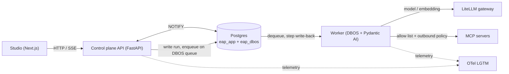

# Architecture Design

> Version: 2026-11-18 · 繁體中文版：[architecture.zh-TW.md](./architecture.zh-TW.md)

## Design goals and principles

The first goal of the architecture is: **the lifetime of a run is decided by the database, not by a process.** An agent run can span minutes. A workflow waiting for approval can span days. A process can disappear at any moment because of a deployment, a reschedule or an out-of-memory kill. Only when the two are decoupled can the other goals hold.

The goals, in priority order:

1. **No loss, no repeat.** After any interruption, a run continues from the last completed step. An action on an external system is never executed a second time. When it is uncertain, a person decides.
2. **Tenant isolation is a hard boundary.** Every row, every query and every external connection is bound to a tenant. A tenant can never send code into the execution layer.
3. **One database holds everything.** Queue, events, wait state, vectors and memory are all in the same Postgres. One component fewer means one failure mode fewer and one consistency problem fewer.
4. **Buy the engine, write the glue.** The agent loop, durable execution, vector retrieval and telemetry all use mature open-source components. What is built in-house is the policy, the interface and the rules that join them.
5. **Observable by default.** Every run is one trace. Logs carry the tenant and run id. Usage and cost are written in the same transaction as events.
6. **Boundaries are enforced by tools.** Package layering is locked by import-linter contracts, and a violation fails the build. Only Alembic can change the schema, and the API and Worker refuse to start when the version does not match.

Explicit non-goals: very low latency (persisting each step has a cost, and tens of milliseconds are accepted); a minimal single-tenant deployment (the multi-tenant structure is the default, and no simplified edition is maintained); a general programmatic workflow language (the flow vocabulary is deliberately small, and complex logic goes into the agent).

Technology choices at a glance: Pydantic AI (agent loop and model abstraction), DBOS (durable execution, queues, recovery), FastAPI (control plane), Next.js (Studio), Postgres + pgvector (the only database), Alembic (schema), OpenTelemetry + Grafana LGTM (telemetry), LiteLLM (model and embedding gateway, self-hosted).

## System overview and components

Two processes do the work: the API and the Worker. They never call each other directly. They share only Postgres. The API records a run and enqueues it on a DBOS queue. The Worker takes the run and writes each step back.

Solid lines are the request path and the result flow back. Dashed lines are telemetry. All outbound calls to models and MCP go through the allow lists and the outbound policy.

| Component | Location | Responsible for | Not responsible for |
| --- | --- | --- | --- |
| Studio | `apps/studio`, Next.js, :3000 | Edit and publish agents, Playground, live workflow graph, traces, logs, metrics, knowledge bases, memory view | Any business logic. It talks to the API only through HTTP and SSE |
| Control plane API | `apps/api`, FastAPI, :8000 | Every human-initiated write: authentication, tenant authorization, publish checks, run recording, queueing, SSE streaming, proxying Loki queries | Running agents. It never imports the Worker, the runtime or Pydantic AI |
| Worker | `apps/worker`, DBOS + Pydantic AI | Runs agents, tools, workflow nodes, knowledge ingest, memory observation and the retention sweep as durable workflows. Each model request and tool call is a step | Accepting HTTP. It takes work only from the queue |
| Postgres | `eap_app` + `eap_dbos`, pgvector | The single source of truth: product data, runs, events, side effects, DBOS system tables and queues, vectors, memory |  |
| Model gateway | Self-hosted LiteLLM | Chat and embedding models: one allow list, one price table |  |
| MCP servers | Registered by tenants, Streamable HTTP | External tools | Reaching the platform's internal network (the outbound policy blocks it) |
| Observability | `grafana/otel-lgtm` | Traces, logs, metrics. The API queries Loki on :3100 |  |

## Lifecycle of a run

Every kind of run uses the same hand-off: the control plane writes the row and enqueues it, and the execution layer dequeues it and persists step by step. Take an agent run started from the Playground as an example:

1. **Studio sends the request**: `POST /agents/{id}/runs`, with the input, an optional `run_id` (idempotent retry), the request context, a model override or `version: "draft"`.
2. **The API checks and records**: the request guard limits size and characters. The version is resolved. The context fields are validated. The model allow list is checked. The run row is inserted with status `queued`.
3. **The API enqueues**: `DBOSClient.enqueue` puts `eap.agent_run` on `eap-agent-runs`, with workflow id = run id. If enqueueing fails, the run is marked failed. A retry with the same run id attaches to the same workflow.
4. **The Worker starts**: the `eap.start_run` step reads the model, context and draft snapshot from the run row and marks the run running. On replay it sees the same values. `eap.load_history`, `eap.load_memory`, `eap.memory_recall` and `eap.input_processors` run in order.
5. **The agent runs step by step**: each model request and tool call is one DBOS step. Events are written by `eap.append_event` with an idempotent `event_key` and a continuous `seq`. Usage and cost go in the same transaction as the event. Side-effect tools go through `run_side_effect`.
6. **Studio watches live**: durable events and transient token deltas reach the API through Postgres `NOTIFY`, and the API sends them as SSE. After a client disconnects, it reconnects with `after_seq` / `Last-Event-ID`.
7. **Finish**: `eap.output_processors`, `eap.memory_index`. `eap.finish_run` writes the terminal state (`completed` / `failed` / `needs_attention`), the totals and `finished_at`. The `end` event closes the stream. If observational memory is enabled, the `eap.memory_observe_run` child workflow is enqueued.

The heartbeat writes `heartbeat_at` every 5 seconds. A running run with no heartbeat for more than 20 seconds is shown in Studio as recovering, until a new Worker takes it over.

| Run kind | Start | DBOS workflow | Special |
| --- | --- | --- | --- |
| Agent | `POST /agents/{id}/runs` | `eap.agent_run` | Version or draft snapshot |
| Conversation turn | `POST /conversations/{id}/runs` | `eap.agent_run` | Carries history; one turn at a time is guaranteed under the conversation row lock |
| Tool test | `POST /tools/{id}/runs` | `eap.tool_run` | Same allow list and side-effect rules |
| Workflow | `POST /workflows/{id}/runs` | `eap.workflow_run` | Agent step = child `eap.agent_run`; parallel branch = child `eap.workflow_branch` |
| Approval wait | Inside a workflow | DBOS `recv` | The decision event is the source of truth; the deadline is re-checked every hour |
| Knowledge ingest | Upload / reindex | `eap.kb_ingest` | Batches are persisted; separate queue |
| Observational memory | End of a turn | `eap.memory_observe_run` | Serialized per conversation |
| Retention sweep | Schedule | `eap.memory_retention` | Cutoff time follows the schedule time |

## Durable execution contract

These five rules make a Worker crash safe. The crash-injection suite in `tests/recovery` kills real API and Worker processes (`os._exit(137)`) at 19 named points and verifies each rule.

| Contract | Content | Implementation |
| --- | --- | --- |
| One workflow per run | Workflow id = run id. On restart, DBOS recovers the unfinished workflows of the same app version and replays recorded steps without executing them again | DBOS; fixed `EAP_EXECUTOR_ID` |
| Events are idempotent and gap-free | Each event has a unique `event_key`, and an append on replay returns the existing row. `seq` is assigned under the run row lock | `eap_run_store` |
| Side effect: reserve, call, complete | First write the `side_effects` key `run_id:tool_call_id`, then call, then write the result. If the process dies after the call and before the record, recovery finds the reservation, ends in `needs_attention` and does not call again | `eap_runtime.run_side_effect` |
| All non-determinism is recorded | The clock (`eap.workflow_clock`), the "latest version" resolution (`eap.workflow_resolve_agent`), environment limits and approval deadlines are each read once inside a step | The `eap.*` steps |
| Step errors are replayable | Exceptions inside a step are pickle-safe. DBOS stores them and raises them again with the same type, fields and message | Exception class design |

**How replay works**: a recovered Worker re-runs the workflow function from the beginning. Each step first looks up the DBOS system table. If there is an output, it is returned directly. If not, the step really runs. Therefore the code between steps must be deterministic: it must not read the clock, query the database or use random numbers.

**The approval race**: approve, reject and timeout compete under the run row lock for the same decision event key, and the first to write wins. The workflow waits through DBOS `recv` and re-checks the deadline every hour (`EAP_APPROVAL_POLL_SECONDS`). The decision event is the source of truth, not the DBOS message.

**Version and recovery constraint**: DBOS recovers only pending workflows with the same `application_version` as its own. When a new version is deployed, the unfinished runs of the old version are not taken over by the new Worker automatically. See "Deployment, operations and version compatibility".

## The workflow interpreter and its relation to agents

**The agent thinks, and the workflow orchestrates.** An agent is one piece of reasoning. It is driven by a model, decides which tools to call and how many times, and does not know which step of a flow it is in. A workflow does not reason. It only passes, decides and waits: the node order, the branch conditions and the approval points are set by the designer in Studio.

When a workflow calls an agent, the agent run becomes a child run (`runs.parent_run_id`, `parent_step_id`) and goes through the full `eap.agent_run`. The flow advances only after the result is handed back. Both are durable runs hosted by the same engine, so recovery of an agent child run is exactly the same as a standalone run.

### Why an interpreter and not plain Python

DBOS is already "code as workflow". Adding a data-driven flow graph on top of it is a decision with a cost. The reasons, by strength:

1. **Multi-tenancy: a flow is tenant data, not platform code.** The Worker is a single process that serves all tenants. Letting tenants upload Python would be arbitrary code execution. So "branch conditions are data, never code".
2. **Versioning and publishing.** Workflows and agents share the same governance: draft → publish → immutable version → compare → restore. Only a structure stored in Postgres can do this.
3. **Visualization.** Studio draws a run as a live graph, including branches not yet reached. A declarative graph can be rendered by nature.
4. **Parameterized approval.** Who is awaited, the deadline and the timeout path are the designer's settings, not hard-coded in a program.
5. **Small vocabulary.** There are only five node kinds: agent step, tool call, conditional branch, parallel branch, human approval. Complex logic is handled by the model inside the agent. The interpreter abstracts only the layer of "which agent follows which agent".

The cost: one more execution model to maintain, and expressiveness that is always lower than Python (loops, complex transformations and dynamic fan-out all wait for new node types). A bug in the interpreter affects all tenants. Platform engineers can still write Python workflows directly with DBOS inside the Worker (such as `eap.kb_ingest` and `eap.memory_retention`). The two layers coexist and serve different people.

### Interpreter implementation notes

| Node | Step | Description |
| --- | --- | --- |
| Agent step | `eap.workflow_resolve_agent` → child `eap.agent_run` | The "latest version" is resolved inside a step, so it does not change on replay. Output limit 32 KiB |
| Tool call | `eap.workflow_tool_call` | Goes through `run_side_effect`, with the same rules as a tool call inside an agent |
| Conditional branch | Pure data comparison | Reads a field of the previous step's output. Deterministic, so no step is needed |
| Parallel branch | child `eap.workflow_branch` × n | Each branch is an independent DBOS workflow. One failing does not affect the others |
| Human approval | `eap.workflow_approval_begin` → `recv` → `eap.workflow_approval_decision` | The deadline is read once in `eap.workflow_clock`. The decision event is the source of truth |

The flow context (the accumulation of each step's output) is limited to 1 MiB. A single run lasts at most 14 days. Workflow events are written to the parent run's event log, and the live graph in Studio reads from the same SSE.

## Knowledge bases and memory

Both share pgvector, but they are different concepts: a knowledge base is documents uploaded by the tenant, and memory is information produced by conversations.

### Knowledge bases

| Layer | Responsible for | Implementation |
| --- | --- | --- |
| Extraction and chunking | Pure functions, no I/O: Markdown (markdown-it-py; a `#` inside a code block is not a heading), HTML (stdlib parser; drops script / style / nav), plain text. A section smaller than `min_tokens` is merged into the next one. A section larger than `max_tokens` is split by paragraph, line, sentence, word, character, with `overlap_tokens` overlap. The embedding text has the form `path: <doc> > <h1> > <h2>\n\ntitle: <heading>\n\n<text>`, with a sha256 and an anchor URL | `eap_knowledge` (imports only stdlib, `eap_schemas`, markdown\_it) |
| Ingest | DBOS workflow: `eap.start_ingest` → `eap.kb_chunk` → `eap.kb_embed_batch` × n → `eap.kb_finalize`. A failure goes to `eap.kb_mark_failed`. Each batch has at most 32 inputs / 16,384 tokens, with a 120-second timeout. After an interruption, it continues from the unfinished batch | `eap.kb_ingest`, queue `eap-kb-ingest` |
| Embedding | Through the self-hosted LiteLLM gateway, Qwen3-VL-Embedding-8B, 1024 dimensions. Allow list `EAP_ALLOWED_EMBEDDING_MODELS`. The embedding gateway can differ from the chat gateway | Worker embedding service |
| Storage and index | `kb_chunks.embedding` is pgvector with HNSW `vector_cosine_ops` (m=16, ef\_construction=64). Generations support an atomic switch after a reindex | Migration 0011 |
| Retrieval | Platform tool `retrieve(search_query, knowledge_base?)`, injected automatically when there is a knowledge base. Results ≤ 24 KiB. Citation numbers are continuous across the whole run and are not renumbered by multiple retrievals | `platform_tools.py` |

### Memory

| Kind | When | Storage | Key points |
| --- | --- | --- | --- |
| Working memory | Read by `eap.load_memory` before a turn. The agent writes with the `update_working_memory` tool | `working_memories`, scope resource or conversation | Template mode (Markdown ≤ 16 KiB) or schema mode (JSON depth 3, 50 properties, deep merge). Writes have a ledger, so replay writes only once. The API uses ETag |
| Observational memory | Child workflow `eap.memory_observe_run` after a turn ends | `memory_observations`; a reflection replaces old rows through `superseded_by` | The observer model is required. `observe_after_tokens` 12,000, `keep_recent_turns` 4, `reflect_after_tokens` 8,000. Serialized per conversation |
| Semantic recall | `eap.memory_recall` before a turn, `eap.memory_index` after a turn | `message_embeddings` (pgvector) | `top_k` 4 (≤ 10), surrounding context 1 (≤ 3). 8-second timeout with one retry. Results ≤ 8 KiB |
| Retention | Scheduled `eap.memory_retention`, default 03:00 UTC | Days set separately for four categories | Batches of 500, at most 2000 steps. Cutoff time = schedule time − days, so the decision is the same after recovery |
| Forgetting | API | `memory_forget_watermarks` | One user in one agent or in the whole tenant |

The design principle of memory: every read or write of memory is a step, so a replay does not observe twice or embed twice. A memory failure (a recall timeout) does not fail the turn. It only records a warning.

## Security boundaries and multi-tenancy

| Boundary | Rule | Implementation |
| --- | --- | --- |
| Tenant | Every query is filtered by the caller's tenant. Child rows are bound to the tenant by composite foreign keys. An id from another tenant returns 404. `tenant_id`, `user_id` and `run_id` are reserved context fields | All stores; a cross-tenant scenario is tested for every task |
| Input | Request guard: 413 / 415 / 422, input not echoed. 401 comes before 422 | `request_guard.py` |
| Outbound | MCP is https only. Private, loopback, link-local and metadata addresses are rejected. DNS is re-checked at connect time. Redirects are not followed. Identity encoding is required. Response ≤ 1 MiB. In development, `EAP_MCP_DEV_ALLOW_HOSTS` allows specific hosts | `eap_secrets` outbound policy and HTTP client |
| Secrets | MCP header values are AES-GCM encrypted, rotated with `EAP_SECRETS_KEY` + `EAP_SECRETS_OLD_KEYS`, and never returned. Tool results, errors, logs and spans mask known secrets. A malformed key format makes startup fail | `eap_secrets` |
| Model | The model and embedding-model allow lists are checked at publish, at run start and before every call. Tests use `test:*` scripted models | `EAP_ALLOWED_MODELS`, `EAP_ALLOWED_EMBEDDING_MODELS`, `EAP_ALLOWED_TOOLS` |
| Guardrails | Processors are attached declaratively to the agent: PII redaction, RE2 blocklist (with a match and time budget), length, moderation. Matched text is not stored | `eap_processors` |
| Code | A tenant can never send code into the Worker. Flows and branch conditions are data | Workflow interpreter |
| Deployment | Secrets are obtained from a password-manager service at deploy time and are not stored in GitHub. Deployment is limited to the owner and to main | `deploy.yml` |

Trust model: the platform administrator is trusted (sets the environment and allow lists). The tenant administrator is trusted inside their own tenant. Agent output, MCP server responses and knowledge base document content are untrusted data and are persisted only after processors and masking.

### Identity integration (planned: ZITADEL)

Identity is delegated to an external identity provider. The tenant and roles come from the token, and resource-level authorization stays in the platform database. The multi-organization model of ZITADEL maps one-to-one to `Principal(tenant_id, user_id)`, so the API changes only in one place, `current_principal`.

| Durable | ZITADEL | Platform-side change |
| --- | --- | --- |
| The platform | An Instance and one Project, granted (project grant) to each customer organization | None |
| `tenant_id` | Organization. A user always belongs to one organization | Organization id → `tenant_id`. The tenant row is lazily created on first sign-in. The SQL tenant filter is unchanged |
| `user_id` | The `sub` of a human user | `sub` → `user_id`, not email |
| Roles (admin / designer / approver / viewer) | Project roles, assigned by the customer organization's administrator, carried in the token | New `Principal.roles` field. `Depends(require_role(...))` is added to write and approval routes |
| Tenant API keys (scope `mcp` / `manage` / `otlp`) | Machine user + PAT or JWT profile key, with scopes drawn from the same roles | In oidc mode both bearer kinds are accepted (JWT through ZITADEL, the `eap_` prefix through the key table), and one is retired after one version |
| Studio and external front-end sign-in | OIDC PKCE, hosted login page, MFA, enterprise IdP connected by SAML / OIDC | Studio switches to OIDC. No in-house login is built |
| User deletion → memory forgetting | Actions / events trigger an external call | Calls `DELETE /memory/resources/{rid}` |
| Resource-level authorization | Out of scope (roles are project-level) | `resource_grants(tenant_id, resource_type, resource_id, principal, role)`, written in the same transaction as the resource |

The `oidc` branch of `current_principal`: verify the JWT with JWKS (the app is set to JWT access tokens, with no introspection on each call). Request the scope `urn:zitadel:iam:user:resourceowner` to get the organization id, and `urn:zitadel:iam:org:projects:roles` to get roles (the claim names follow the documentation of the deployed version).

Three rules do not change. Authorization is done only at the API at write time. The Worker trusts the principal recorded in the run row, and replay does not redo authorization. Tenant isolation stays in SQL, so the identity provider is an addition and not the only line of defense. ZITADEL needs a database of its own. This is a split made because "trust differs and a resource can have only one owner", and its cost is one more service. OpenFGA is introduced only when the sharing graph becomes complex (groups, nesting, listing "all agents I can see"). OPA solves attribute-based policy. The existing allow lists and outbound policy are already covered by Python plus tests, so they are not replaced.

## Package layering and dependency rules

The import-linter contracts in the root `pyproject.toml` lock the following boundaries. Crossing a line fails the build. The dependency direction is top-down: an upper layer may use a lower layer, and a lower layer does not know the upper one.

| Package | Responsible for | Allowed dependencies |
| --- | --- | --- |
| `eap_api`, `eap_worker` | The two applications | All lower layers. `eap_api` never imports `eap_worker`, `eap_runtime` or `pydantic_ai`. `eap_worker` never imports `eap_api` |
| `eap_observability` | Tracing, tenant-labelled logs, output masking | The only package that may import OpenTelemetry |
| `eap_runtime` | Agent runtime: tool registry, run dependencies, `run_side_effect` | No persistence layer, no web, no DBOS |
| `eap_run_store` | Runs, events, side effects, conversations, usage, metrics, trace reads, memory | No runtime, no web, no agent, no DBOS |
| `eap_secrets` | Encryption, outbound policy, masking, MCP failure classification | No web, no database, no agent, no platform package |
| `eap_processors` | RE2 guardrail engine | stdlib, `eap_schemas`, `re2` |
| `eap_knowledge` | Extraction and chunking | stdlib, `eap_schemas`, `markdown_it` |
| `eap_db` | Alembic migrations and table definitions, the only schema owner | sqlalchemy, alembic |
| `eap_schemas` | Pure contracts: agent / workflow specifications, tool and processor declarations, request context, memory settings | Imports no internal package; no sqlalchemy, fastapi, pydantic\_ai, dbos |

The reasons for the nine contracts come from four questions: which code must run without heavy dependencies installed (pure packages); which code lives in different processes (the API and Worker never import each other); which resource may have only one owner (schema → `eap_db`, OTel → `eap_observability`); and which mistakes agents often make (running an agent directly inside the API). A new package adds its contract in the same milestone plan.

Studio (`apps/studio`) is a separate pnpm workspace. It talks to the API only through HTTP and SSE. What is shared is the JSON shape of `eap_schemas`, not code.

## Deployment, operations and version compatibility

**Development stack**: `scripts/dev-up.sh` starts, in order, Postgres (compose, with pgvector), `grafana/otel-lgtm` (OTLP :4318, Grafana :3002, Loki :3100), the Worker (`dev-worker.sh` supervisor loop, fixed executor id), the API (:8000) and Studio (:3000), each waiting for its health check. The two databases `eap_app` and `eap_dbos` are created by `dev-db.sh`.

**Production**: k3s, `deploy/k8s` kustomize. `deploy.yml` is triggered manually. After deploying on a self-hosted runner, it runs a loopback smoke test against the API and Studio. Models and embeddings go through the self-hosted LiteLLM.

**Startup checks**: the API and Worker refuse to start when Alembic is not at head. A malformed `EAP_SECRETS_KEY` also refuses startup. Run the migration first, then start the processes.

**Version compatibility and recovery**: DBOS recovery is bound to `application_version` (`EAP_APP_VERSION`). A new Worker takes over only pending workflows of the same version. With frequent deployments this is the real difficulty. There are three paths:

1. **Fixed app version**, declaring the same version even when the code changed. Simple, but if the step order or names changed, replay misaligns. Suitable only for deployments that do not change the workflow structure.
2. **Rolling deployment**, where the old Worker finishes the runs in hand before retiring. Correct, but an approval wait can last days, so the old version must live long.
3. **DBOS fork / version migration**: fork the pending workflows of the old version under the new version, from a given step.

The current approach is not yet written as an explicit strategy in the repo. It is recommended to decide it in the next deployment-related milestone, and to mark "a deployment that changes step structure" as needing strategy 2 or 3.

**Observability and operations**: one trace per run (Tempo). Logs carry the tenant and run id (Loki, queried by the API's `GET /logs`). Metrics (Prometheus). The Metrics page of Studio is computed from `run_model_requests` and the run rows. The `recovering` status, a `needs_attention` ending and the DBOS queue depth are the three signals that should be monitored.

**CI**: hosted CI (about 18 minutes) runs lint, DB-free unit tests and Studio. The self-hosted CI Heavy runs the db / run-store / API suites on push to main, and adds the worker and recovery suites every night. The heavy runner has no Loki, so the related tests are skipped by default.

## Design trade-offs and alternatives

| Decision | Chosen | Not chosen | Reason | Cost |
| --- | --- | --- | --- | --- |
| Durable execution | DBOS (inside Postgres) | Temporal, a hand-built state machine | No extra service. Native integration with Pydantic AI. Step output shares the transaction boundary of product data | Recovery is bound to the app version. Workflow code must be deterministic |
| Queue and live notification | DBOS queue + Postgres NOTIFY | Redis, Kafka | One database | NOTIFY is not durable, so durable events must be written to rows first, and deltas may be dropped |
| Vectors | pgvector HNSW | A dedicated vector store | Same database, same tenant filter | Needs re-evaluation at tens of millions of vectors |
| Agent framework | Pydantic AI | LangGraph, hand-written | Type safety, DBOS integration, model abstraction | Follows its version changes |
| Workflow | Declarative interpreter | Let tenants write Python | Multi-tenant isolation, versioning, visualization | Two execution models; lower expressiveness |
| Model access | Self-hosted LiteLLM gateway | Direct connection to each vendor | One allow list, one price table, models can be swapped | The gateway becomes a single point; behavior that needs patches (streaming usage) |
| Front-end streaming | Native durable-event SSE | Use AG-UI directly as the core | The durable event log is the source of truth. AG-UI is an output adapter for external front ends | One more adapter layer |
| Studio | Written in-house, aligned with the layout and UX of Mastra Studio | Adopt an existing console | An existing product is tied to its own runtime. Its code, name and logo are not used | About 89,000 lines of TypeScript, the largest in-house amount |
| Memory | All three at once | Build one first | Pydantic AI has no built-in memory. Align with competitor capability | Deeper than the defaults of most frameworks |
| Identity and authorization (planned) | ZITADEL for identity and tenant roles. Resource-level authorization in Postgres | OpenFGA, OPA / Rego, Cedar, in-house login | Organization = tenant, one-to-one. The existing policies are attribute-based and already covered by Python. The resource-authorization data is already in Postgres, and a same-transaction write avoids dual writes | One more service and database. OpenFGA to be re-evaluated when the sharing graph grows complex |

**Minimal versus simple**: the architecture is simple (one database, two processes, a one-sentence failure model). The solution is not minimal (about 36,000 lines of Python, 89,000 lines of TypeScript, 102,000 lines of tests, 13 migrations). The extra surface is all one kind of complexity, correctness and tenancy, and not a variety of components. No engine was rebuilt. What is built in-house is the glue. The closest thing to a "rebuild" is the workflow interpreter, and the reasons are in the previous section.

## Risks and to-do

| Risk | Impact | Current state and recommendation |
| --- | --- | --- |
| DBOS app version and frequent deployments | Pending runs of the old version (especially multi-day approvals) hang after a deployment | No explicit strategy. Decide in the next deployment milestone, and add a crash-matrix scenario that simulates a version switch |
| Production authentication is not yet connected to enterprise identity | In production, Studio can use only a dev bearer or a key. No SSO / MFA | AUTH milestone: OIDC mode, Studio sign-in, roles. Identity provider ZITADEL |
| LiteLLM gateway single point | All models and embeddings stop | Self-hosted on a self-hosted host. Patches are lost after a redeploy and must go into the container build |
| An interpreter bug affects all tenants | All flows fail | Covered by the crash matrix. A new node type (loop) needs a new crash point |
| No run cancel endpoint | A runaway long run can only wait for the 14-day limit | To do |
| The knowledge base accepts only Markdown / HTML / plain text | Enterprise documents are mostly PDF / Office | P1 follow-up. Attachments round two (R2) land first |
| pgvector performance at tens of millions of vectors | Retrieval slows down | Not measured. Evaluate partitioning or an external vector store then |
| The in-house amount of Studio | Highest maintenance cost | Test count must not fall; test id contract. Evaluate necessity before parity round three |
| All three memory kinds at once | Large configuration surface, hard for users to choose | Observational memory needs a specified model, so the cost is visible. Consider disabling by default |

To do (2026-11-19): the next milestone has been consolidated into four tracks. **A Identity and Governance** (ZITADEL OIDC, roles, a resource-authorization table, append-only audit, quotas and budgets; identity is built as a core interface plus a plug-in) comes first, because the Principal and the route guards are the base of the other three. **B Authoring and Verification** (per-node editing, engine-level dry run, re-run from step N, tool mocks, publish gates) shares step snapshots and run replay. **C Connect and Embed** (webhooks, notification connectors, OAuth, SDK, local runner) depends on the keys of A and the replay of B. **D Operate** (model fallback, alerts, bundles and promotion, injection detection, data governance, SDK documentation) is interleaved, and model degradation and alerts are worth doing before B. Not listed but still undecided: the version strategy for the DBOS app version with frequent deploys (the step-snapshot replay of B is directly related to it).
