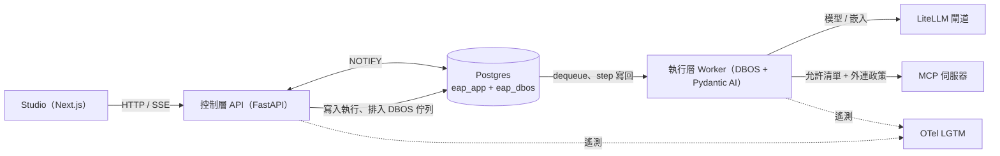

# 本方案 架構設計文件

> 版本：2026-11-18

## 設計目標與原則

架構的首要目標是：**一次執行的壽命由資料庫決定，不由行程決定。** Agent 執行可能跨越數分鐘，工作流等待審批可能跨越數天；行程則會因部署、重排、記憶體不足而隨時消失。兩者解耦之後，其餘目標才成立。

目標依優先順序：

1. **不遺失、不重做。** 任何中斷後，執行從最後一個完成的步驟繼續；對外部系統的動作絕不執行第二次，不確定時交人判斷。
2. **租戶隔離是硬邊界。** 每一筆資料、每一次查詢、每一個外部連線都綁定租戶；租戶永遠不能把程式碼送進執行層。
3. **一個資料庫承載一切。** 佇列、事件、等待狀態、向量、記憶都在同一個 Postgres；少一個元件就少一種故障、少一種一致性問題。
4. **買引擎，寫黏合。** Agent 迴圈、持久執行、向量檢索、遙測都採用成熟開源元件；自建的是政策、介面與把它們接在一起的規則。
5. **可觀測是預設。** 每次執行是一條追蹤；日誌帶租戶與執行 id；用量與成本和事件同一交易寫入。
6. **邊界由工具強制。** 套件分層以 import-linter 契約鎖定，違反則建置失敗；Schema 只有 Alembic 能改，API 與 Worker 在版本不符時拒絕啟動。

明確不追求的事：極低延遲（每步落地有成本，接受數十毫秒）；單租戶的極簡部署（多租戶結構是預設，不另維護簡化版）；通用的程式化工作流語言（流程詞彙刻意很小，複雜邏輯放進 Agent）。

技術選型一覽：Pydantic AI（Agent 迴圈與模型抽象）、DBOS（持久執行、佇列、恢復）、FastAPI（控制層）、Next.js（Studio）、Postgres + pgvector（唯一資料庫）、Alembic（Schema）、OpenTelemetry + Grafana LGTM（遙測）、LiteLLM（模型與嵌入閘道，自架）。

## 系統全貌與元件

兩個行程做事：API 與 Worker。它們永不直接呼叫對方，只共用 Postgres：API 記錄執行並排入 DBOS 佇列，Worker 取出執行並把每一步寫回。

實線是請求路徑與結果回流，虛線是遙測。模型與 MCP 的外連都經過允許清單與外連政策。

| 元件 | 位置 | 負責 | 不負責 |
| --- | --- | --- | --- |
| Studio | `apps/studio`，Next.js，:3000 | 編輯與發布 Agent、Playground、工作流即時圖、追蹤、日誌、指標、知識庫、記憶檢視 | 任何業務邏輯；只透過 HTTP 與 SSE 跟 API 溝通 |
| 控制層 API | `apps/api`，FastAPI，:8000 | 每一個人為寫入：驗證、租戶授權、發布檢查、記錄執行、排佇列、SSE 串流、代查 Loki | 執行 Agent；永不 import Worker、runtime 或 Pydantic AI |
| 執行層 Worker | `apps/worker`，DBOS + Pydantic AI | 以持久工作流執行 Agent、工具、工作流節點、知識導入、記憶觀察、保留期掃除；每個模型請求與工具呼叫是一個步驟 | 接受 HTTP；只從佇列取工作 |
| Postgres | `eap_app` + `eap_dbos`，pgvector | 單一事實來源：產品資料、執行、事件、副作用、DBOS 系統表與佇列、向量、記憶 |  |
| 模型閘道 | 自架 LiteLLM | 聊天與嵌入模型；一個允許清單、一套計價 |  |
| MCP 伺服器 | 租戶註冊，Streamable HTTP | 外部工具 | 進入平台內網（外連政策擋住） |
| 觀測 | `grafana/otel-lgtm` | 追蹤、日誌、指標；API 以 :3100 查 Loki |  |

## 一次執行的生命週期

每種執行都走同一套交接：控制層寫列、排佇列；執行層取出、逐步落地。以從 Playground 啟動的 Agent 執行為例：

1. **Studio 發出請求**：`POST /agents/{id}/runs`，帶輸入、可選的 `run_id`（冪等重試）、請求上下文、模型覆寫或 `version: "draft"`。
2. **API 檢查並記錄**：請求守衛限制體積與字元；解析版本；驗證上下文欄位；檢查模型允許清單；插入執行列，狀態 `queued`。
3. **API 排入佇列**：`DBOSClient.enqueue` 把 `eap.agent_run` 放上 `eap-agent-runs`，工作流 id = run id。排隊失敗則標為 failed；同 run id 重試會接到同一個工作流。
4. **Worker 啟動**：`eap.start_run` 步驟從執行列讀模型、上下文、草稿快照並標為 running；重放時看到同樣的值。`eap.load_history`、`eap.load_memory`、`eap.memory_recall`、`eap.input_processors` 依序執行。
5. **Agent 逐步執行**：每次模型請求與工具呼叫是一個 DBOS 步驟；事件以 `eap.append_event` 帶冪等 `event_key` 與連續 `seq` 寫入；用量與成本和事件同一交易。副作用工具走 `run_side_effect`。
6. **Studio 即時觀看**：持久事件與暫時 token 增量經 Postgres `NOTIFY` 到 API，API 以 SSE 送出；客戶端斷線後用 `after_seq` / `Last-Event-ID` 接回。
7. **結束**：`eap.output_processors`、`eap.memory_index`；`eap.finish_run` 寫入終態（`completed` / `failed` / `needs_attention`）、總量與 `finished_at`；`end` 事件關閉串流。若啟用觀察記憶，排入 `eap.memory_observe_run` 子工作流。

心跳每 5 秒寫 `heartbeat_at`；超過 20 秒無心跳的 running 執行在 Studio 顯示為 recovering，直到新 Worker 接手。

| 執行種類 | 啟動 | DBOS 工作流 | 特別之處 |
| --- | --- | --- | --- |
| Agent | `POST /agents/{id}/runs` | `eap.agent_run` | 版本或草稿快照 |
| 對話回合 | `POST /conversations/{id}/runs` | `eap.agent_run` | 帶歷史；對話列鎖下保証一次一回合 |
| 工具測試 | `POST /tools/{id}/runs` | `eap.tool_run` | 同一套允許清單與副作用規則 |
| 工作流 | `POST /workflows/{id}/runs` | `eap.workflow_run` | Agent 步驟 = 子 `eap.agent_run`；平行分支 = 子 `eap.workflow_branch` |
| 審批等待 | 工作流內 | DBOS `recv` | 決定事件是事実来源；每小時重檢期限 |
| 知識導入 | 上傳 / 重建 | `eap.kb_ingest` | 批次落地；独立佇列 |
| 觀察記憶 | 回合結束 | `eap.memory_observe_run` | 每對話串行 |
| 保留期掃除 | 排程 | `eap.memory_retention` | 截止時間依排程時間 |

## 持久執行契約

這五條規則讓 Worker 崩潰變得安全。`tests/recovery` 的崩潰注入套件在 19 個具名點殺掉真実的 API 與 Worker 行程（`os._exit(137)`），逐條驗證。

| 契約 | 內容 | 实作 |
| --- | --- | --- |
| 一次執行一個工作流 | 工作流 id = run id。重啟時 DBOS 恢復同 app version 的未完成工作流，重放已記錄步驟而不重執行 | DBOS；`EAP_EXECUTOR_ID` 固定 |
| 事件冪等且無空洞 | 每事件唯一 `event_key`，重放的 append 回傳既有列；`seq` 在執行列鎖下配號 | `eap_run_store` |
| 副作用：預留、呼叫、完成 | 先寫 `side_effects` 鍵 `run_id:tool_call_id`，再呼叫，再寫結果。死在呼叫後、記錄前：恢復時找到預留，結束在 `needs_attention`，不再呼叫 | `eap_runtime.run_side_effect` |
| 非決定性全部記錄 | 時鐘（`eap.workflow_clock`）、「最新版本」解析（`eap.workflow_resolve_agent`）、環境上限、審批期限都在步驟裡讀一次 | 各 `eap.*` 步驟 |
| 步驟錯誤可重放 | 步驟內的例外 pickle-safe，DBOS 儲存後以同型別、欄位、訊息重新招出 | 例外類別設計 |

**重放的形式**：恢復的 Worker 從工作流函式開頭重跑；每個步驟先查 DBOS 系統表，有輸出就直接回傳，沒有才真的執行。因此步驟之間的程式碼必須是決定性的：不讀時鐘、不查資料庫、不用隨機數。

**審批的競爭**：同意、拒絕、超時三方在執行列鎖下競爭同一個決定事件鍵，先寫入者勝；工作流透過 DBOS `recv` 等待，每小時（`EAP_APPROVAL_POLL_SECONDS`）重檢一次期限。決定事件是事実来源，不是 DBOS 訊息。

**版本與恢復的約束**：DBOS 只恢復與自己 `application_version` 相同的待定工作流。部署新版時，舊版本的未完成執行不會被新 Worker 自動接手。見《部署、運維與版本相容》。

## 工作流直譯器與 Agent 的關係

**Agent 負責思考，工作流負責編排。** Agent 是一次推理：由模型驅動，自己決定呼叫哪些工具、呼叫幾次，不知道自己在流程的哪一步。工作流不推理，只做傳遞、判斷與等待：節點順序、分支條件、審批點由設計者在 Studio 決定。

工作流呼叫 Agent 時，Agent 執行成為子執行（`runs.parent_run_id`、`parent_step_id`），走完整的 `eap.agent_run`；結果交回後流程才前進。兩者都是持久執行，由同一引擎承載，所以 Agent 子執行的恢復與單獨執行完全一样。

### 為什麼是直譯器，不是直接寫 Python

DBOS 本身就是「程式碼即工作流」，在它之上再做一層資料驅動的流程圖，是有代價的決定。理由依強度：

1. **多租戶：流程是租戶的資料，不是平台的程式碼。** Worker 是服務所有租戶的单一行程；讓租戶上傳 Python 等於任意程式碼執行。所以「分支條件是資料，永遠不是程式碼」。
2. **版本化與發布。** 工作流與 Agent 共用草稿 → 發布 → 不可變版本 → 比較 → 還原的治理；存進 Postgres 的結構才做得到。
3. **可視覺化。** Studio 把執行畫成即時圖，包含尚未跑到的分支；宣告式圖天生可渲染。
4. **審批參數化。** 等誰、期限、超時路徑是設計者的設定，不寫死在程式裡。
5. **詞彙小。** 節點只有五種：Agent 步驟、工具呼叫、條件分支、平行分支、人工審批。複雜邏輯在 Agent 內部由模型處理；直譯器只抽「哪個 Agent 接哪個 Agent」這一層。

代價：多一個要維護的執行模型，表達力永遠低於 Python（迴圈、複雜轉換、動態 fan-out 都要等新節點型別）；直譯器的 bug 影響所有租戶。平台工程師仍可在 Worker 裡用 DBOS 直接寫 Python 工作流（如 `eap.kb_ingest`、`eap.memory_retention`）；兩層並存，面向不同的人。

### 直譯器的实作要點

| 節點 | 步驟 | 說明 |
| --- | --- | --- |
| Agent 步驟 | `eap.workflow_resolve_agent` → 子 `eap.agent_run` | 在步驟裡解析「最新版本」，重放時不變；輸出上限 32 KiB |
| 工具呼叫 | `eap.workflow_tool_call` | 走 `run_side_effect`，與 Agent 內的工具呼叫同一套規則 |
| 條件分支 | 純資料比對 | 讀前一步輸出的欄位，決定性，不需要步驟 |
| 平行分支 | 子 `eap.workflow_branch` × n | 每条分支是獨立 DBOS 工作流；一條失敗不影響其他 |
| 人工審批 | `eap.workflow_approval_begin` → `recv` → `eap.workflow_approval_decision` | 期限在 `eap.workflow_clock` 讀一次；決定事件是事実来源 |

流程上下文（各步輸出的累積）上限 1 MiB；單次執行最長 14 天。工作流的事件寫在父執行的事件日誌，Studio 的即時圖從同一條 SSE 讀。

## 知識庫與記憶

兩者共用 pgvector，但是不同的概念：知識庫是租戶上傳的文件，記憶是對話產生的資訊。

### 知識庫

| 層 | 負責 | 实作 |
| --- | --- | --- |
| 抽取與切塊 | 純函式，無 I/O：Markdown（markdown-it-py，程式碼區裡的 `#` 不是標題）、HTML（stdlib parser，丟掉 script / style / nav）、純文字。小於 `min_tokens` 的節併入下一節，大於 `max_tokens` 的依段、行、句、詞、字元切，帶 `overlap_tokens` 重畳。嵌入文字形式 `path: <doc> > <h1> > <h2>\n\ntitle: <heading>\n\n<text>`，附 sha256 與鏃點 URL | `eap_knowledge`（只 import stdlib、`eap_schemas`、markdown\_it） |
| 導入 | DBOS 工作流：`eap.start_ingest` → `eap.kb_chunk` → `eap.kb_embed_batch` × n → `eap.kb_finalize`；失敗走 `eap.kb_mark_failed`。每批最多 32 輸入 / 16,384 tokens，超時 120 秒；中斷後從未完成批次繼續 | `eap.kb_ingest`，佇列 `eap-kb-ingest` |
| 嵌入 | 經自架 LiteLLM 閘道，Qwen3-VL-Embedding-8B，1024 維；允許清單 `EAP_ALLOWED_EMBEDDING_MODELS`；嵌入閘道可與聊天閘道不同 | Worker embedding service |
| 儲存與索引 | `kb_chunks.embedding` 為 pgvector，HNSW `vector_cosine_ops`（m=16，ef\_construction=64）；以世代（generation）支持重建索引後原子切換 | 遷移 0011 |
| 檢索 | 平台工具 `retrieve(search_query, knowledge_base?)`，有知識庫時自動注入；結果 ≤ 24 KiB；引用編號跨整次執行連續，多次檢索不重編 | `platform_tools.py` |

### 記憶

| 種類 | 何時 | 儲存 | 要點 |
| --- | --- | --- | --- |
| 工作記憶 | 回合前 `eap.load_memory` 讀；Agent 以 `update_working_memory` 工具寫 | `working_memories`，範圍 resource 或 conversation | 模板模式（Markdown ≤ 16 KiB）或 schema 模式（JSON 深度 3、50 屬性，深度合併）；寫入有帳本，重放只寫一次；API 用 ETag |
| 觀察記憶 | 回合結束後的子工作流 `eap.memory_observe_run` | `memory_observations`，反思以 `superseded_by` 取代舊列 | 觀察者模型必填；`observe_after_tokens` 12,000、`keep_recent_turns` 4、`reflect_after_tokens` 8,000；每對話串行 |
| 語意回想 | 回合前 `eap.memory_recall`，回合後 `eap.memory_index` | `message_embeddings`（pgvector） | `top_k` 4（≤ 10），前後文 1（≤ 3）；8 秒超時一次重試；結果 ≤ 8 KiB |
| 保留期 | 排程 `eap.memory_retention`，預設 03:00 UTC | 四類各自天數 | 批次 500，最多 2000 步；截止時間 = 排程時間 − 天數，恢復後決定一致 |
| 遺忘 | API | `memory_forget_watermarks` | 單一使用者在一個 Agent 或全租戶 |

記憶的設計原則：每一次對記憶的讀寫都是步驟，所以重放不會重複觀察、重複嵌入；記憶失敗（回想超時）不讓回合失敗，只記錄警告。

## 安全邊界與多租戶

| 邊界 | 規則 | 实作 |
| --- | --- | --- |
| 租戶 | 每個查詢以呼叫者租戶過濾；子列以複合外鍵綁租戶；他租戶 id 回 404；`tenant_id`、`user_id`、`run_id` 為保留上下文欄位 | 全部 store；每任務必測跨租戶情境 |
| 輸入 | 請求守衛：413 / 415 / 422，不回顯輸入；401 先於 422 | `request_guard.py` |
| 外連 | MCP 僅 https；拒絕私有、回錄、link-local、metadata 位址；連線時重檢 DNS；不跟隨重導；要求 identity encoding；回應 ≤ 1 MiB；開發環境以 `EAP_MCP_DEV_ALLOW_HOSTS` 放行 | `eap_secrets` 外連政策與 HTTP client |
| 秘密 | MCP 標頭值 AES-GCM 加密，`EAP_SECRETS_KEY` + `EAP_SECRETS_OLD_KEYS` 輪替，永不回傳；工具結果、錯誤、日誌、span 遮罩已知秘密；金鑰格式錯誤則啟動失敗 | `eap_secrets` |
| 模型 | 模型與嵌入模型允許清單在發布、執行開始、每次呼叫前檢查；測試用 `test:*` 腳本模型 | `EAP_ALLOWED_MODELS`、`EAP_ALLOWED_EMBEDDING_MODELS`、`EAP_ALLOWED_TOOLS` |
| 防護 | 處理器宣告式掛在 Agent：PII 遮罩、RE2 封鎖（帶匹配與時間預算）、長度、審核；匹配文字不儲存 | `eap_processors` |
| 程式碼 | 租戶永遠不能把程式碼送進 Worker；流程與分支條件是資料 | 工作流直譯器 |
| 部署 | 秘密從 密碼管理服務 在部署時取得，GitHub 不存；部署僅限 owner、僅限 main | `deploy.yml` |

信任模型：平台管理者可信（設定環境與允許清單）；租戶管理者在自己租戶內可信；Agent 的輸出、MCP 伺服器的回應、知識庫文件內容都是不可信資料，經處理器與遮罩後才落地。

### 身分整合（規劃：ZITADEL）

身分交給外部身分供應者，租戶與角色從 token 来，資源級授權留在平台資料庫。ZITADEL 的多組織模型和 `Principal(tenant_id, user_id)` 一對一，所以 API 只改 `current_principal` 一處。

| 本方案 | ZITADEL | 平台端改動 |
| --- | --- | --- |
| 平台 | Instance 與一個 Project，授權（project grant）給每個客戶組織 | 無 |
| `tenant_id` | Organization；使用者永遠屬於一個組織 | 組織 id → `tenant_id`；第一次登入 lazy-create 租戶列；SQL 租戶過濾不變 |
| `user_id` | Human user 的 `sub` | `sub` → `user_id`，不用 email |
| 角色（admin / designer / approver / viewer） | Project roles，客戶組織管理者指派，進 token | `Principal.roles` 新欄；`Depends(require_role(...))` 加在寫入與審批路由 |
| 租戶 API 金鑰（scope `mcp` / `manage` / `otlp`） | Machine user + PAT 或 JWT profile key，scope 用同一套 roles | oidc 模式下兩種 bearer 並收（JWT 走 ZITADEL，`eap_` 前綴走金鑰表），一版後收掉 |
| Studio 與外部前端登入 | OIDC PKCE，託管登入頁，MFA，企業 IdP 以 SAML / OIDC 接入 | Studio 改走 OIDC；不自建登入 |
| 使用者刪除 → 記憶遺忘 | Actions / 事件觸發外部呼叫 | 呼叫 `DELETE /memory/resources/{rid}` |
| 資源級授權 | 不在範圍（roles 是專案層級） | `resource_grants(tenant_id, resource_type, resource_id, principal, role)`，與資源同交易寫入 |

`current_principal` 的 `oidc` 分支：以 JWKS 驗 JWT（app 設為 JWT access token，不每次 introspection）；請求 scope `urn:zitadel:iam:user:resourceowner` 取組織 id，`urn:zitadel:iam:org:projects:roles` 取 roles（claim 名稱依部署版本文件為準）。

三條不變的規則：授權只在 API 的寫入時刻做，Worker 信任執行列記錄的 principal，重放不重做授權；租戶隔離仍在 SQL，身分供應者是加法不是唯一防線；ZITADEL 自己要一個資料庫，是「信任不同、資源只能有一個主人」的拆分，代價是多一個服務。OpenFGA 等到分享圖變複雜（群組、巢狀、列出「我能看的所有 Agent」）再引入；OPA 解的是屬性型政策，現有的允許清單與外連政策已用 Python 加測試覆蓋，不換。

## 套件分層與依賴規則

根 `pyproject.toml` 的 import-linter 契約鎖定下列邊界，跨線則建置失敗。自上而下是依賴方向：上層可以用下層，下層不知道上層。

| 套件 | 負責 | 允許的依賴 |
| --- | --- | --- |
| `eap_api`、`eap_worker` | 兩個應用 | 下層全部；`eap_api` 永不 import `eap_worker`、`eap_runtime`、`pydantic_ai`；`eap_worker` 永不 import `eap_api` |
| `eap_observability` | 追蹤、租戶標籤日誌、輸出遮罩 | 唯一可 import OpenTelemetry 的套件 |
| `eap_runtime` | Agent 執行環境：工具註冊、執行依賴、`run_side_effect` | 無持久層、無 web、無 DBOS |
| `eap_run_store` | 執行、事件、副作用、對話、用量、指標、追蹤讀取、記憶 | 無執行環境、無 web、無 Agent、無 DBOS |
| `eap_secrets` | 加密、外連政策、遮罩、MCP 失敗分類 | 無 web、無資料庫、無 Agent、無平台套件 |
| `eap_processors` | RE2 防護引擎 | stdlib、`eap_schemas`、`re2` |
| `eap_knowledge` | 抽取與切塊 | stdlib、`eap_schemas`、`markdown_it` |
| `eap_db` | Alembic 遷移與表定義，唯一 schema 所有者 | sqlalchemy、alembic |
| `eap_schemas` | 純契約：Agent / 工作流規格、工具與處理器宣告、請求上下文、記憶設定 | 不 import 任何內部套件，無 sqlalchemy、fastapi、pydantic\_ai、dbos |

九条契約的理由從四個問題来：哪些程式碼必須在不裝重依賴時也能跑（純套件）；哪些程式碼是不同行程（API / Worker 互不 import）；哪個資源只能有一個主人（schema → `eap_db`，OTel → `eap_observability`）；哪些常被代理寫錯（在 API 裡直接跑 Agent）。新套件在里程碑計畫裡同時新增它的契約。

Studio（`apps/studio`）是獨立的 pnpm 工作區，只透過 HTTP 與 SSE 與 API 溝通；共用的是 `eap_schemas` 的 JSON 形狀，不共用程式碼。

## 部署、運維與版本相容

**開發棧**：`scripts/dev-up.sh` 依序啟動 Postgres（compose，含 pgvector）、`grafana/otel-lgtm`（OTLP :4318，Grafana :3002，Loki :3100）、Worker（`dev-worker.sh` 監督迴圈，executor id 固定）、API（:8000）、Studio（:3000），每個等健康檢查。兩個資料庫 `eap_app`、`eap_dbos` 由 `dev-db.sh` 建立。

**生產**：k3s（studio\_cf），`deploy/k8s` kustomize；`deploy.yml` 手動觸發，在自架 runner 上部署後對 API 與 Studio 跑回路 smoke test。模型與嵌入經自架 LiteLLM。

**啟動檢查**：API 與 Worker 在 Alembic 不在 head 時拒絕啟動；`EAP_SECRETS_KEY` 格式錯誤拒絕啟動。先跑遷移，再起行程。

**版本相容與恢復**：DBOS 恢復綁 `application_version`（`EAP_APP_VERSION`）：新 Worker 只接手同版本的待定工作流。部署頻繁時這是真正的難點，三条路：

1. **固定 app version**，程式碼改了仍宣告同版本：簡單，但若步驟順序或名稱變了，重放會錯位。只適合不改工作流結構的部署。
2. **滾動部署**，舊版 Worker 跑完手上的執行再退場：正確，但審批等待可能跨天，舊版要活很久。
3. **DBOS fork / 版本遷移**：把舊版本的待定工作流在新版本下從某一步重新分叉。

目前的做法尚未在 repo 裡寫成明確策略；建議在下一個部署相關里程碑裡決定，並把「改步驟結構的部署」標為需要策略 2 或 3。

**觀測與運維**：每次執行一條追蹤（Tempo）；日誌帶租戶與執行 id（Loki，API 的 `GET /logs` 代查）；指標（Prometheus）；Studio 的 Metrics 頁從 `run_model_requests` 與執行列算。`recovering` 狀態、`needs_attention` 結束、DBOS 佇列深度是三個該被監控的訊號。

**CI**：hosted CI（約 18 分）跑 lint、DB-free 單元測試、Studio；自架 CI Heavy 在 push main 時跑 db / run-store / API 套件，每夜加 worker 與 recovery。Heavy runner 沒有 Loki，相關測試預設 skip。

## 設計取捨與替代方案

| 決定 | 選了 | 沒選 | 理由 | 代價 |
| --- | --- | --- | --- | --- |
| 持久執行 | DBOS（Postgres 內） | Temporal、自建狀態機 | 不多一套服務；Pydantic AI 原生整合；步驟輸出與產品資料同一個交易邊界 | 恢復綁 app version；工作流程式碼必須決定性 |
| 佇列與即時通知 | DBOS 佇列 + Postgres NOTIFY | Redis、Kafka | 一個資料庫 | NOTIFY 不持久，所以持久事件必須先落列，增量可丟 |
| 向量 | pgvector HNSW | 專用向量庫 | 同一個資料庫、同一筆租戶過濾 | 千萬級向量時需重評 |
| Agent 框架 | Pydantic AI | LangGraph、自寫 | 型別安全、DBOS 整合、模型抽象 | 跟隨其版本變動 |
| 工作流 | 宣告式直譯器 | 讓租戶寫 Python | 多租戶隔離、版本化、可視覺化 | 兩套執行模型；表達力較低 |
| 模型存取 | 自架 LiteLLM 閘道 | 直連各廠商 | 一個允許清單、一套計價、模型可換 | 閘道成為單點；需要補丁的行為（串流用量） |
| 前端串流 | 原生持久事件 SSE | 直接用 AG-UI 作為核心 | 持久事件日誌是事实来源；AG-UI 作為輸出轉接器給外部前端 | 多一層轉接 |
| Studio | 自寫，對齊 Mastra Studio 的配置與 UX | 改用現成控制台 | 現成品綁自己的 runtime；不使用其程式碼、名稱、標誌 | 約 89,000 行 TypeScript，最大的自製量 |
| 記憶 | 三種同時做 | 先做一種 | Pydantic AI 無內建記憶；對齊競品能力 | 深度超過多數框架預設 |
| 身分與授權（規劃） | ZITADEL 做身分與租戶角色；資源級授權在 Postgres | OpenFGA、OPA / Rego、Cedar、自建登入 | 組織 = 租戶一對一；現有政策都是屬性型且已用 Python 覆蓋；資源授權資料本就在 Postgres，同交易寫入無雙寫 | 多一個服務與資料庫；分享圖變複雜時要再評 OpenFGA |

**最小與簡單的區別**：架構是簡單的（一個資料庫、兩個行程、一句話的故障模型），解法不是最小的（約 36,000 行 Python、89,000 行 TypeScript、102,000 行測試、13 個遷移）。額外的表面全部是正確性與租戶這一種複雜度，不是元件種類。沒有重造引擎；自建的是黏合。最接近「重造」的是工作流直譯器，理由在上一節。

## 風險與待辦

| 風險 | 影響 | 現狀與建議 |
| --- | --- | --- |
| DBOS app version 與頻繁部署 | 舊版本的待定執行（尤其跨天審批）在部署後挂起 | 無明確策略；下一個部署里程碑決定，并加一個崩潰矩陣情境模擬版本切換 |
| 生產驗證尚未接企業身分 | Studio 在生產只能靠 dev bearer 或金鑰；無 SSO / MFA | AUTH 里程碑：OIDC 模式、Studio 登入、角色；身分供應者 ZITADEL |
| LiteLLM 閘道單點 | 模型與嵌入全停 | 自架在 自架主機；補丁在重部署後會掉，要進容器建置 |
| 直譯器 bug 影響所有租戶 | 流程全部失敗 | 崩潰矩陣已覆蓋；新節點型別（迴圈）要配新崩潰點 |
| 無執行取消端點 | 失控的長執行只能等 14 天上限 | 待辦 |
| 知識庫只收 Markdown / HTML / 純文字 | 企業文件多為 PDF / Office | P1 後續；附件第二輪（R2）先落地 |
| pgvector 在千萬級向量的表現 | 檢索變慢 | 未測；到時評估分區或外部向量庫 |
| Studio 的自製量 | 維護成本最高 | 測試數不得下降、test id 契約；對等第三輪前評估必要性 |
| 記憶三種同時上 | 設定面大，使用者難選 | 觀察記憶需指定模型，成本可見；考慮預設關閉 |

待辦（2026-11-19）：下一個 milestone 已整併為四條主線。**A Identity 與 Governance**（ZITADEL OIDC、role、資源授權表、append-only 稽核、配額與預算；身分做成核心介面加插件）先做，因為 Principal 與路由守衛是其餘三條的基礎。**B Authoring 與 Verification**（per-node 編輯、引擎層 dry run、從第 N 步重跑、工具 mock、發佈門檻）共用 step 快照與 run 重放。**C Connect 與 Embed**（webhook、通知連接器、OAuth、SDK、本機 runner）依賴 A 的金鑰與 B 的重放。**D Operate**（模型 fallback、告警、bundle 與 promotion、注入偵測、資料治理、SDK 文件）穿插，模型降級與告警在 B 之前就值得做。未列入但仍待決：DBOS app version 與頻繁 deploy 的版本策略（B 的 step 快照重放會與它直接相關）。
